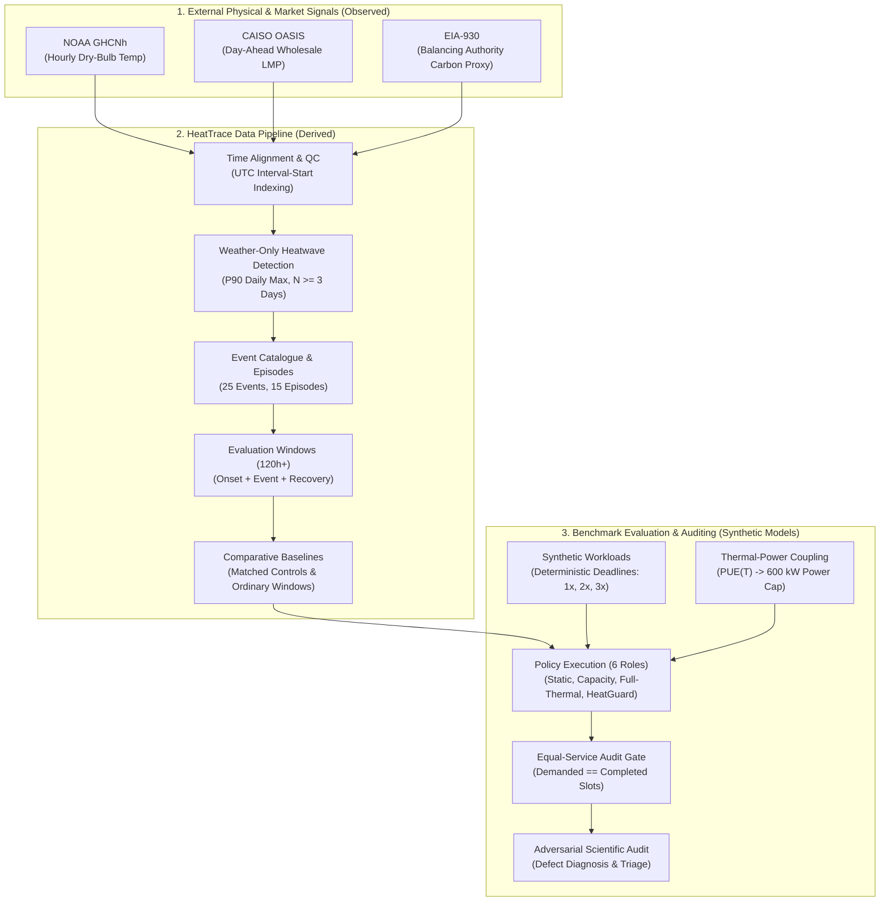

# HeatTrace

**A Historical Heatwave Dataset and Evaluation Benchmark for Sustainable Cloud Scheduling**

[](data/archive/heattrace_v1_d5b3c86/verify_archive.py)
[](docs/p11_final_results_audit.md)
[](docs/dataset.md)
[](#citation-and-license-status)

---

## Project Overview

**HeatTrace** is an empirical evaluation framework and historical benchmark dataset designed to evaluate sustainable, carbon- and cost-aware cloud data-center schedulers under authentic extreme weather conditions.

Modern sustainable schedulers dynamically defer, advance, or throttle batch computing workloads to align with fluctuating wholesale electricity prices and renewable grid emissions. However, existing evaluations routinely presume benign weather or static cooling overhead (Power Usage Effectiveness, PUE). In physical reality, extreme atmospheric heatwaves degrade cooling heat-rejection efficiency, driving PUE sharply upward. Under fixed electrical facility power caps (e.g., hard interconnection limits), escalating cooling power directly cannibalizes the power available to computing hardware, severely reducing effective IT throughput.

HeatTrace couples historical dry-bulb temperatures (NOAA GHCNh), wholesale day-ahead electricity prices (CAISO OASIS), and balancing-authority carbon-intensity proxies (EIA-930) with a piecewise thermal sensitivity model to evaluate scheduling behavior across complete extreme-event windows.

> **Primary Contribution Notice**: The primary scientific contribution of HeatTrace is **dataset curation, benchmark construction, provenance locking, and validity auditing**—not a novel scheduling algorithm or mathematical optimizer.

### Research Status Overview

| Research Effort | Historical Scope | Evidence Classification | Current Status | Key Finding / Limitation |
|---|---|---|---|---|
| **Original Single-Station Study (v1)** | SFO (2022–2025) | Frozen Confirmatory Case Series | **Complete / Limited Result** | 3 confirmatory events ($N=3$); H1 supported, H2/H3 partial, H4 unestimable, H5 unsupported. |
| **Multi-Station California Extension (B2)** | 5 CA Stations (2022–2026) | Exploratory Dataset Development | **BLOCKED by Adversarial Audit** | Valid 25-event catalogue; forecast-aware scheduling compromised by cross-station forecast transfer. |
| **Global Expansion** | Multi-Continent (2022–2026) | Methodological Proposal | **Planned Future Work** | Unexecuted proposal for post-examination research; no global experiments implemented. |

---

## Research Motivation

Sustainable computing benchmarks frequently evaluate algorithms over arbitrarily selected, benign time periods (e.g., mild spring or autumn weeks). Even when high temperatures are considered, prior evaluations commonly rely on synthetic single-day step-functions, unconstrained energy accounting, or isolated peak afternoon hours.

HeatTrace investigates whether evaluating schedulers across **complete, multi-day heatwave trajectories** (spanning pre-event onset, sustained multi-day extreme heat, and post-event recovery) alters simulated feasibility boundaries and policy separations relative to matched seasonal controls and event-blind baseline windows.

*Boundary clarification*: HeatTrace evaluates algorithmic scheduling constraints under simulated power caps. It does not observe physical hardware failures or claim that atmospheric heatwaves generally cause commercial data-center outages.

---

## Key Contributions

- **Synchronized Empirical Data Integration**: Timestamp alignment and quality control for hourly NOAA dry-bulb temperatures, CAISO wholesale LMPs, and EIA balancing-authority carbon proxies.
- **Weather-Only Heatwave Detection**: Objective isolation of multi-day heatwaves based strictly on empirical temperature percentiles ($P_{90}$, $\ge 3$ consecutive days), fully independent of computational or market outcomes.
- **Standardized Multi-Day Windows with Matched Controls**: Construction of standardized evaluation windows capturing onset, peak, and recovery phases, paired with outcome-blind matched seasonal controls ($T_{\max} \le 22.0^\circ\mathrm{C}$) and event-blind ordinary windows.
- **Physical Thermal-Power Facility Coupling**: A piecewise PUE model coupling ambient temperature to facility power draw, enforcing hard electrical power caps that dynamically throttle effective IT compute capacity.
- **Uncompromising Equal-Service Gate**: Rigorous rejection of policy comparisons where schedulers achieve apparent cost or carbon reductions simply by dropping, delaying, or evading demanded computational work.
- **Transparent Reproduction & Adversarial Audit**: Complete same-environment reproduction verification across 756 simulation cells (Phase P11) and an independent adversarial scientific audit (Stage 2 B2 Audit) that transparently catalogs protocol defects and non-estimable claims.

---

## Quick Links

- **Event Catalogues**:
  - [Station Events Catalogue (25 events)](data/v2/events/p12_b2_station_events.csv)
  - [Regional Episodes Catalogue (15 episodes)](data/v2/events/p12_b2_regional_episodes.csv)
  - [Hourly Phase Labels Preview (100 rows)](data/v2/events/p12_b2_hourly_phase_labels_preview.csv)
  - [Original Confirmatory Triplet Index](data/benchmarks/p6_event_control_index.csv)
- **Documentation & Evidence**:
  - [Documentation Hub](docs/README.md)
  - [Dataset & Provenance Guide](docs/dataset.md)
  - [Research Claims & Evidence Map](docs/heattrace_research_claims_and_evidence.md)
  - [Stage 2 Adversarial Scientific Correctness Audit](reproduction_audits/stage2_b2/stage2_scientific_correctness_report.md)
  - [Professor Presentation Brief](docs/heattrace_professor_presentation_brief.md)
  - [Website & Presentation Source Package](docs/heattrace_website_presentation_source.md)
- **Reproducibility & Verification**:
  - [Immutable Archive Manifest](data/archive/heattrace_v1_d5b3c86/archive_manifest.json)
  - [Archive Verification Script](data/archive/heattrace_v1_d5b3c86/verify_archive.py)
  - [Primary Confirmatory Result Figure (H1 / H3)](data/figures/p6_f4_h1_sensitivity.png)

---

## Dataset Coverage and Availability

HeatTrace datasets span two distinct releases: the original single-station confirmatory dataset (v1) and the multi-station California extension (Track B2).

| Dataset Dimension | Original Single-Station Benchmark (v1) | Multi-Station California Extension (Track B2) |
|---|---|---|
| **Geographic Scope** | San Francisco International Airport (`SFO` / `USW00023234`) | 5 Stations: SFO, Sacramento (`SAC`), Fresno (`FAT`), Redding (`RDD`), Los Angeles (`LAX`) |
| **Climatic Regimes** | Northern coastal marine airport | Coastal marine (SFO, LAX) and inland Central Valley (SAC, FAT, RDD) |
| **Wholesale Pricing Hubs** | CAISO `TH_NP15_GEN-APND` | CAISO `TH_NP15_GEN-APND`, `TH_ZP26_GEN-APND`, `TH_SP15_GEN-APND` |
| **Screening Period** | June 1 – September 30, 2022–2025 (485 days) | June 1 – September 30, 2022–2026 (2026 provisional) |
| **Detected Event Catalogue** | 4 events (1 development + 3 confirmatory triplets) | 25 station events across 15 regional connected episodes |
| **Joint Evaluation Status** | All 3 confirmatory triplets fully evaluated | 12 eligible (2023–2025), 9 excluded (2022), 4 provisional (2026) |
| **Public Hourly Benchmark** | **1,440 rows** (`p6_benchmark_hourly.parquet`, tracked) | **100-row preview tracked**; full 4,320-row export is local-only |
| **Composite Hourly Key** | `(triplet_id, window_type, timestamp_utc)` | `(event_id, timestamp_utc)` |
| **Grid Demand Field** | `demand_mw` (balancing authority megawatts) | `demand_mwh` (hourly megawatt-hours) |

### The 2022 Annual Joint-Source Gate Limitation

All nine 2022 station events in Track B2 are **meteorologically authentic heatwaves** that fully satisfied weather screening. Their exclusion from the joint simulation matrix was caused by an automated, conservative annual coverage gate triggered by a single missing EIA carbon interval on **`2022-06-13 at 17:00 UTC`**—an interval occurring entirely outside every authentic heatwave window. They remain valid catalogue events, but were excluded from multi-source simulation.

---

## System Architecture



---

## Experimental Evaluation & Confirmatory Findings (v1)

The original HeatTrace study evaluated six scheduling policy roles across a frozen combinatorial matrix of **756 simulation cells** in Northern California:
- **Core Deployable Cohort** (432 cells): `static_unaware`, `capacity_aware`, `full_thermal_aware` evaluated across heatwave and matched control contexts.
- **Event-Blind Baseline Cohort** (216 cells): Same three deployable policies evaluated in event-blind ordinary windows.
- **Heuristic Comparator Cohort** (72 cells): `heatguard_calibrated` and `heatguard_fixed` safety buffers.
- **Hindsight Oracle Cohort** (36 cells): `oracle_full_thermal_aware` (non-deployable hindsight upper bound).

> **Statistical Unit of Inference**: The 756 simulation cells represent deterministic permutations of workload seeds, multipliers, facility models, and thermal curves across **three independent historical events ($N=3$)**. The historical event is the independent unit of inference, not the individual cells.

### Canonical H1–H5 Hypothesis Assessment

| Hypothesis | Stated Scientific Claim | Event-Level Effects ($N=3$) | Canonical Classification | Key Methodological Boundary |
|---|---|---|---|---|
| **H1: Static Feasibility** | Power cap degrades static feasibility envelope during heatwaves | CONF1: $-0.5\times$, CONF2: $-0.5\times$, CONF3: $0.0\times$ | **SUPPORTED** | Coarse multiplier grid ($\{1\times, 2\times, 3\times\}$); weaker sensitivity on low thermal curve. |
| **H2: Capacity Awareness** | Forecast awareness recovers feasibility loss or reduces violations | Boundary: $0.0\times$ across all; Violations: $-1.0\,\text{h}$, $-0.5\,\text{h}$, N/A | **PARTIALLY SUPPORTED** | Modest violation reduction; zero tested boundary recovery under heavy loads. |
| **H3: Blind Understatement** | Event-blind windows obscure equal-service policy separations | Non-zero gaps: HW: 24/36, 24/36, 0/36; Blind: 0/36, 0/36, 0/36 | **PARTIALLY SUPPORTED** | 48 tie-to-nontie transitions; **zero strict ranking reversals**; control also separated in CONF1. |
| **H4: Forecast Attribution** | Improved forecast accuracy causally drives superior scheduling | Not estimable from frozen confirmation matrix | **NOT ESTIMABLE** | Omission of controlled same-scheduler forecast-source intervention. |
| **H5: HeatGuard Heuristic** | Calibrated margin outperforms fixed margin and baselines | Calibrated beat fixed comparator in 0/3 events | **NOT SUPPORTED** | Small calibrated margin ($\approx 0.016$) failed to buffer against large heatwave forecast errors. |

---

## Multi-Station California Extension (Track B2)

Track B2 expanded HeatTrace across five California stations to explore geographic heterogeneity (G1–G5). An independent adversarial audit ([Stage 2 Audit Report](reproduction_audits/stage2_b2/stage2_scientific_correctness_report.md)) classified Track B2 as **BLOCKED**, uncovering critical methodological traps:

1. **Unauthorized Neural Forecast Transfer**: The execution runner hardcoded the SFO-trained TinyLSTM neural network, feature scaler, and calibration parameters, applying them directly to non-SFO stations (SAC, FAT, RDD, LAX). This violated protocol and **invalidated 3,960 forecast-dependent cells (61.1% of the 6,480-cell matrix)**.
2. **Severe Equal-Service Attrition**: In within-window policy comparisons, **only 7 of 66 heatwave trios passed equal service (10.61%)**. Under stressed $2\times$ and $3\times$ workloads, exactly **0 of 22 trios passed**. High-load cost and carbon claims are non-estimable.
3. **Ordinary-Window Overlap**: Of 240 sampled ordinary windows, **146 overlap with another selected window**, sharing up to 72 hours of identical weather and market data.
4. **Surviving Narrow Result**: Static temperature-unaware scheduling under a power cap showed positive heatwave-minus-control violation hours in **6 of 6 paired regional episodes** (median $+8.08$~hours). This narrow finding does not consume the invalid transferred forecast.

---

## Installation

HeatTrace requires **Python 3.11+**.

```bash
# Clone the repository
git clone https://github.com/Sid-DudeD017/HeatTrace.git
cd HeatTrace

# Create and activate virtual environment
python3 -m venv .venv
source .venv/bin/activate  # On Windows: .venv\Scripts\activate

# Install editable package with core development dependencies
python -m pip install --upgrade pip
python -m pip install -e '.[dev]'
```

*Dependency notes*:
- Core package metadata declares `pandas`, `pyarrow`, and `pyyaml`.
- The codebase also imports `numpy` directly (currently arriving transitively).
- Scientific analysis and plotting modules require `scipy` and `matplotlib`.
- Neural forecasting modules require PyTorch (`torch`, installable via the `.[ml]` extra).
- A fully locked cross-platform lockfile is not currently supplied; installing `.[dev]` alone does not support every advanced training or plotting script.

---

## Quick Start (Read-Only Artifact Inspection)

Inspect public repository artifacts directly without running expensive simulations:

### 1. Inspect the Station Events Catalogue
```bash
python - <<'PY'
import pandas as pd
events = pd.read_csv("data/v2/events/p12_b2_station_events.csv")
print(events[[
    "event_id", "station_code", "local_start_date", "local_end_date",
    "regional_episode_id", "weather_eligibility_status", "joint_evaluation_eligibility"
]].to_string(index=False))
PY
```

### 2. Inspect Regional Connected Episodes
```bash
python - <<'PY'
import pandas as pd
episodes = pd.read_csv("data/v2/events/p12_b2_regional_episodes.csv")
print(episodes[[
    "regional_episode_id", "member_event_count", "distinct_station_count",
    "station_codes", "eligibility_summary"
]].to_string(index=False))
PY
```

### 3. Verify the Immutable v1 Archive
```bash
python data/archive/heattrace_v1_d5b3c86/verify_archive.py
```
*Expected output*: `54 inventory files verified`, scientific decision: `LIMITED RESULT`.

### 4. Run Lightweight Repository Smoke Tests
```bash
python -m pytest -q -p no:cacheprovider tests/test_smoke.py
```
*Expected output*: `4 passed`.

### 5. Inspect CLI Command Interfaces
```bash
python -m heattrace.cli --help
python scripts/p12_b2_acquire_sources.py --help
python scripts/p12_b2_detect_events.py --help
```

### Advanced Workflows and Required Inputs
Full provider data re-acquisition (`scripts/p12_b2_acquire_sources.py`) and full simulation runners require uncommitted provider caches, external network access, and extended compute time. The function `run_phase4_pipeline()` is an internal library routine, not a standalone CLI. Running the 756-cell or 6,480-cell simulation matrices is not recommended during ordinary repository review.

---

## Repository Structure

```
HeatTrace/
├── src/heattrace/
│   ├── ingest/          # NOAA, CAISO, and EIA ingestion and quality-control
│   ├── process/         # Alignment, event detection, controls, and window extraction
│   ├── workload/        # Deterministic deadline batch job generators
│   ├── forecast/        # TinyLSTM architecture, dataset splits, and calibration
│   ├── thermal/         # PUE formulas, power caps, effective capacity, and policies
│   ├── policy/          # Shared greedy solvers and baseline scheduling logic
│   ├── experiments/     # Confirmatory (v1) and extension (B2) execution runners
│   └── evaluation/      # Equal-service auditing, H1–H5 and G1–G5 analysis
├── configs/             # Frozen experimental protocols and model specifications
├── scripts/             # Data acquisition and event detection entry points
├── data/
│   ├── archive/         # Immutable v1 canonical archive (54 verified payloads)
│   ├── benchmarks/      # Tracked public benchmark hourly parquets and triplet indices
│   ├── events/          # Original v1 heatwave and control catalogues
│   ├── v2/              # Track B2 multi-station catalogues, tables, and parquets
│   └── workloads/       # Tracked synthetic job arrival CSV vectors
├── docs/                # Comprehensive research protocols, learning guides, and audits
├── reproduction_audits/ # Independent adversarial scientific audit of Track B2
├── tests/               # Unit, integration, smoke, and regression test suites
├── paper/               # Complete Springer Nature LaTeX manuscript (local-only)
└── .site-publish/       # Interactive React/Vite presentation project (local-only)
```

---

## Research Paper Status

A complete, 30-page Springer Nature journal-article LaTeX manuscript has been authored and compiled locally under [paper/](paper/main.pdf).
- **Manuscript Scope**: 27 substantive body pages (before references), 8 figures, 6 tables, and 12 verified references.
- **Repository Status**: `paper/` is maintained locally in the working workspace and is not currently tracked on the public GitHub tree.
- **Author Review**: Tracking or publishing a curated manuscript release bundle is an explicit author-controlled decision.

---

## Research Presentation Status

An interactive, browser-based React/Vite research presentation explorer exists locally under `.site-publish/heattrace-presentation/`.
- **Local Verification**: Current local typecheck and 23 tests pass cleanly.
- **Repository Status**: `.site-publish/heattrace-presentation/` is a separate, dirty local Git repository with no configured remote; it is not registered as a Git submodule and is not tracked on the public GitHub tree.
- **Public Documentation**: Tracked presentation briefings are available in [docs/heattrace_professor_presentation_brief.md](docs/heattrace_professor_presentation_brief.md) and [docs/heattrace_website_presentation_source.md](docs/heattrace_website_presentation_source.md).

---

## Reproducibility Levels

| Reproducibility Level | Verified Status | Description and Current Limitations |
|---|---|---|
| **Level 1: Public Artifact Inspection** | **Fully Verified** | All primary catalogues, controls, preview signals, and analysis tables are tracked and publicly cloneable. |
| **Level 2: Archive Integrity** | **Fully Verified** | Automated verification script confirms bit-level integrity across 54 of 54 frozen payload files (`verify_archive.py`). |
| **Level 3: Same-Environment Reproduction** | **Fully Verified** | Complete re-execution of all 756 confirmatory cells from scratch confirmed exact agreement across all 44 real scientific columns. |
| **Level 4: Independent Clean Checkout** | **Incomplete / Limited** | Clean-checkout reconstruction from raw provider sources is not demonstrated due to ignored raw caches, unpinned dependencies, and missing workload parquets. |

*Test Suite Note*: The repository contains 698 collected tests. Lightweight smoke tests pass (`4 passed`). During auditing, a full test run reached 206 passed and 2 skipped before manual termination after 4m35s; a complete clean-run pass of all 698 tests has not been established.

---

## Key Scientific Limitations

1. **Small Independent Event Sample**: Confirmatory findings are based on exactly three authentic historical events ($N=3$) at a single coastal airport station (`SFO`).
2. **Cross-Year Control Matching**: 2022 heatwaves were paired with June 2024 controls due to authentic data completeness constraints.
3. **Synthetic Facilities and Workloads**: Cooling is governed by a piecewise mathematical formula; facility telemetry from physical production data centers was not utilized.
4. **Proxy Market Signals**: CAISO wholesale trading-hub LMP is not a retail facility tariff, and EIA-930 production-average carbon is not marginal or avoided emissions.
5. **No Causal Forecast Benefits**: The confirmatory matrix lacked controlled forecast-source interventions, preventing causal attribution of neural forecasting.
6. **No Algorithmic Superiority**: The calibrated HeatGuard safety buffer failed to outperform a fixed engineering margin in any tested event.
7. **Track B2 Protocol Violations**: Cross-station neural forecast transfer invalidated 61.1% of the extension matrix; high-load equal-service attrition was severe (0/22 passing).

---

## Planned Global 2022–2026 Expansion

*Notice: This section outlines proposed future work planned for post-examination research. No global experiments have been executed or implemented.*

- **Multi-Continent Climate Selection**: Target 15 major data-center operating regions across North America, Europe, Asia-Pacific, and Latin America.
- **Localized Climatological Thresholds**: Per-station empirical $P_{90}$ and $P_{95}$ heatwave thresholds incorporating wet-bulb temperature ($T_{\mathrm{wb}}$) in humid regions.
- **Harmonized Electricity Market Signals**: Ingest synchronized regional wholesale prices and local marginal emissions factors (e.g., PJM 5-minute marginal carbon, ENTSO-E).
- **Mandatory Station-Specific Forecasting**: Strictly localized forecasting models to eliminate cross-station transfer defects, with counterfactual forecast-source interventions.
- **Standardized Clean-Checkout Packages**: Containerized execution environments with full dependency lockfiles and public data archives.

---

## Data Sources and Attribution

- **NOAA GHCNh**: National Oceanic and Atmospheric Administration Global Historical Climatology Network hourly product ([NOAA GHCNh Portal](https://www.ncei.noaa.gov/products/global-historical-climatology-network-hourly)).
- **CAISO OASIS**: California Independent System Operator Open Access Same-Time Information System ([CAISO OASIS Portal](https://www.caiso.com/todays-outlook/prices)).
- **EIA-930**: U.S. Energy Information Administration Hourly Electric Grid Monitor ([EIA-930 Portal](https://www.eia.gov/electricity/930-content/about.html)).

---

## Citation and License Status

- **Software & Dataset Licensing**: Formal open-source software and data redistribution licenses have not yet been declared in the public tree.
- **Citation Metadata**: Formal citation metadata (`CITATION.cff`) and author attribution are awaiting explicit human author confirmation.
- **Recommended Citation Placeholder**:
  ```bibtex
  @misc{heattrace2026,
    title  = {HeatTrace: A Historical Heatwave Dataset and Evaluation Benchmark for Sustainable Cloud Scheduling},
    author = {[Authors Pending Confirmation]},
    year   = {2026},
    howpublished = {\url{https://github.com/Sid-DudeD017/HeatTrace}}
  }
  ```
