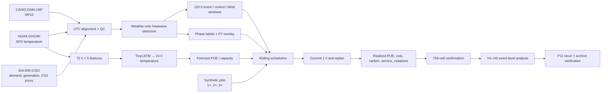

# HeatTrace Complete Learning Guide

**Scope:** implemented HeatTrace v1 through P11 (Days 13–14). Days 15–21 are plans only.  
**Evidence rule:** code and frozen result artifacts take priority over plans. Illustrations are labeled; all unlabeled result values are from repository artifacts.  
**Reference paper:** Hardik Ruparel, “Carbon-aware scheduling and distributionally robust optimization for cloud systems: forecasting, battery storage, and adaptive ambiguity refinement,” *Journal of Cloud Computing* 15, article 84 (2026), [DOI 10.1186/s13677-026-00904-7](https://doi.org/10.1186/s13677-026-00904-7).

---

# Part 1 — Start from absolute basics

## 1.1 Cloud scheduling

**Simple definition.** Cloud scheduling decides **which computing work runs, where it runs, and when it runs**, subject to resource and service constraints.

A **workload** is the work presented to a computing system. A **job** is one schedulable unit of that work. In HeatTrace, a job has an arrival time, a required number of one-hour processing slots, an hourly power draw, a deadline, a priority, a preemption flag, and a maximum parallelism.

A job is **flexible** if the scheduler can choose among several acceptable execution hours. It is **deferrable** if it may wait after arrival. Backups, batch analytics, and model training are typical examples. An interactive video call is usually not deferrable.

A job's **arrival** is its earliest legal start. Its **deadline** is the exclusive end of its legal window: an allocation at hour `h` is legal when `arrival <= h < deadline`. A constraint is a rule every valid schedule must obey—for example, power capacity, maximum concurrent jobs, or completion before deadline.

**Why this matters to HeatTrace.** Flexible work can move toward cheap or low-carbon hours, but only if the chosen hours remain thermally feasible. The core tension is therefore not merely “pick the cleanest hour”; it is “pick a clean hour while completing identical work within deadlines and respecting available capacity.”

## 1.2 Cost, carbon, and units

**Carbon-aware scheduling** moves flexible work toward times or places with lower grid carbon intensity while respecting service constraints.

- **Electricity price**, in USD/MWh, is money per megawatt-hour purchased. Since `1 MWh = 1000 kWh`, consuming 100 kWh at 80 USD/MWh costs `100 × 80 / 1000 = $8`.
- **Grid carbon intensity**, in gCO2/kWh, is a carbon-accounting factor per kilowatt-hour. Consuming 100 kWh at 300 gCO2/kWh gives `100 × 300 / 1000 = 30 kg CO2`.
- Price and carbon are different signals. An hour can be cheap but carbon intensive, or expensive but relatively clean.

They vary hourly because demand, generator availability, fuel mix, transmission congestion, renewable output, market bids, imports, and outages vary. HeatTrace uses CAISO day-ahead LMP for price and an EIA production-average intensity proxy for carbon. The latter is **not** marginal or avoided emissions.

## 1.3 IT power, facility power, and PUE

**IT power** runs servers, storage, and networking. **Facility power** includes IT power plus cooling and other overhead. **Power Usage Effectiveness (PUE)** is

\[
PUE=\frac{P_{facility}}{P_{IT}}.
\]

PUE 1.20 means 1.20 kW enters the facility for each 1.00 kW used by IT; 0.20 kW is overhead. HeatTrace models hotter outside air as increasing PUE above 22°C. This is a transparent simulation, not data-center telemetry (`pue_from_temperature`, `src/heattrace/thermal/model.py:60-93`).

If a facility has a fixed 600 kW power cap, cooling and computing compete for the same cap. At PUE 1.20, 500 kW of IT fits exactly. At PUE 1.50, only `600/1.50 = 400 kW` of IT fits. The relationship is:

```text
temperature rises
      ↓
modeled PUE rises
      ↓
cooling overhead rises
      ↓
available IT capacity falls under a fixed facility cap
      ↓
scheduler has fewer feasible placements
      ↓
cost, carbon, deadline completion, or cap violations may change
```

**Illustrative example 1.** A 100 kW job runs for one hour at 20°C under medium sensitivity. PUE is 1.20, so facility energy is 120 kWh and cooling overhead is 20 kWh. At 300 g/kWh the carbon proxy is 36 kg; at $50/MWh the cost is $6.

**Illustrative example 2.** At 32°C under medium sensitivity, PUE is `1.20 + 0.02×10 = 1.40`. The same job consumes 140 kWh facility energy, creates 40 kWh overhead, costs $7 at $50/MWh, and carries 42 kg at 300 g/kWh. Effective IT capacity is `min(500,600/1.40)=428.57 kW`.

**NOTE ⇒** A heatwave does not automatically cause missed deadlines. It changes modeled overhead and, in the power-capped model, capacity. Whether outcomes change depends on the workload and scheduler.

### What I should remember for my professor

HeatTrace connects weather to computing through an explicit causal model: temperature changes modeled PUE; PUE changes facility energy and power-capped IT capacity; those quantities can change scheduling outcomes. Cost and carbon are separate signals with separate units.

---

# Part 2 — Understand the Ruparel base paper

## 2.1 Verified paper description

**Simple definition.** Ruparel studies geo-distributed cloud scheduling under uncertain electricity prices, carbon intensities, and renewable availability. Jobs must be placed in a region and time while balancing cost, carbon, latency, service constraints, and tail risk.

The paper's architecture uses historical series to forecast price, carbon, and renewables; an LSTM is the learned forecaster and EWMA is a lightweight fallback. Forecast residuals inform ambiguity sets. The scheduler includes renewable supply and battery state/charge/discharge constraints and uses distributionally robust optimization with CVaR and a customized Benders decomposition. Its output is a placement/timing and energy-dispatch plan.

Verified reported benchmark facts: four regions, 24 slots, 100 jobs, eight uncertainty scenarios per instance, and 1,000 out-of-distribution test instances. The paper reports DRO CVaR0.9 carbon of 103.6 kg versus 119.9 kg for the cost-only baseline, expected carbon 89.2 kg versus 89.1 kg for carbon-first, cost $28.17 versus $24.79 for cost-only and $31.64 for carbon-first, and zero SLA violations. These are **Ruparel's results, not HeatTrace results**.

Verified limitations include a convex relaxation followed by greedy integral projection and a battery heuristic in part of the evaluation; the full scheduling-routing-storage problem is therefore not always solved jointly to global optimality.

## 2.2 Four ideas from first principles

### Robust optimization

**Definition.** Choose a decision that works for every value in a specified uncertainty set.

**Illustration.** If tomorrow's carbon intensity is believed to lie between 200 and 500 g/kWh, a robust scheduler evaluates the worst allowed value, rather than trusting 300 exactly. This protects against error but can be conservative.

### Distributionally robust optimization (DRO)

**Definition.** Instead of assuming one probability distribution, optimize against the worst distribution in a family called an **ambiguity set**:

\[
\min_x\ \sup_{Q\in\mathcal A} E_Q[L(x,\xi)].
\]

Here `x` is the schedule, `ξ` is uncertain price/carbon/renewable supply, `L` is loss, and `A` is the allowed set of distributions. In Ruparel, moment- and Wasserstein-based ambiguity descriptions protect against a misspecified forecast distribution. HeatTrace does **not** implement this optimization.

### Wasserstein ambiguity set

**Definition.** Wasserstein distance measures how much probability mass must be moved, and how far, to transform one distribution into another. A radius-`ε` ambiguity set is

\[
\mathcal A=\{Q:W(Q,\hat P)\le \varepsilon\}.
\]

**Illustration.** If historical carbon samples cluster near 250, 300, and 350 g/kWh, nearby distributions may slightly shift those masses. A larger radius permits more severe shifts and yields a more conservative plan. Ruparel adapts the radius as residuals change.

### CVaR

**Definition.** Value-at-Risk at level `α` is a loss threshold; Conditional Value-at-Risk is the average loss in the worst `(1-α)` fraction. One common formula is

\[
CVaR_\alpha(L)=\min_\eta\left[\eta+\frac{1}{1-\alpha}E[(L-\eta)_+]\right].
\]

At `α=0.90`, CVaR focuses on the worst 10% of outcomes. A scheduler with low average carbon but disastrous rare spikes may have bad CVaR. Ruparel penalizes tail carbon/SLA risk; HeatTrace's earlier `dro_inspired` policy merely adds a quantile-based heuristic penalty and explicitly provides no DRO certificate (`src/heattrace/policy/robust.py:1-9,35-108`).

### Benders decomposition

**Definition.** Split a large optimization into a master problem and subproblems. The master proposes strategic decisions; subproblems test feasibility or operating cost. If a proposal fails, a **Benders cut** rules out that bad region. Repeat until bounds meet.

**Illustration.** The master proposes job placements. Each uncertainty scenario checks whether capacity, emissions, and SLA constraints survive. A violation generates a cut. Ruparel uses this idea to manage the robust problem. HeatTrace uses greedy policies and no Benders loop.

## 2.3 Renewables and batteries in Ruparel

Renewables can directly cover some facility energy. A battery has state of charge and charge/discharge efficiencies; it can charge in low-carbon periods and discharge later. These are temporally coupled decisions because energy stored now affects future availability. Ruparel includes compatible linear battery constraints, although its reported greedy path uses a carbon-threshold dispatch heuristic and its relaxed solution is projected to an integer schedule.

### What I should remember for my professor

Ruparel is a geo-distributed, formal risk-aware optimization framework. HeatTrace borrows the broad forecast-aware carbon-scheduling motivation, but it does not reproduce Ruparel's DRO, DRCC, CVaR optimizer, Wasserstein solver, Benders decomposition, renewables, battery, or multi-region placement.

---

# Part 3 — How HeatTrace evolved from the base paper

## 3.1 Motivation and pivot

**Simple definition.** HeatTrace asks whether a carbon-aware scheduler's evaluation changes when complete historical heatwaves and temperature-sensitive facility constraints are made explicit.

The gap targeted by the project was not “invent another full DRO optimizer.” It was that ordinary evaluation windows can hide a thermal pathway: hot air → higher PUE → less IT capacity under a fixed facility cap. Historical heatwaves were chosen because they provide coherent multi-day exposures rather than invented isolated hot hours.

TinyLSTM supplies causal 24-hour temperature forecasts. HeatGuard adds a PUE safety margin when forecast PUE might be lower than realized PUE. The Day 8 development pilot then weakened the original algorithm story: TinyLSTM performed poorly on the development heatwave, phase outputs were incomplete, thermal-aware policies did not cleanly dominate, and the event-blind comparison looked more informative. The study therefore froze a benchmark-validity question for confirmation: do complete events reveal feasibility or policy separation that selected blind windows miss? (`docs/p6_pilot_review.md`; final interpretation in `docs/p6_validity_report.md:45-90`).

## 3.2 Ruparel versus HeatTrace

| Aspect | Ruparel | HeatTrace | Why HeatTrace differs |
|---|---|---|---|
| Core problem | Geo-distributed placement under uncertain grid signals | Single-region historical heatwave benchmark validity | Narrower, auditable case series |
| Forecasts | Price, carbon, renewable; LSTM/EWMA | Temperature TinyLSTM; market forecast provider in rolling harness | Tests thermal mechanism |
| Optimization | Formal DRO/DRCC/CVaR | Greedy heuristics | Independently simplified implementation |
| Ambiguity sets | Moment/Wasserstein, adaptive radius | None | `dro_inspired` is only a heuristic |
| Decomposition | Benders | None | Omitted |
| Energy system | Renewables and battery | Grid price/carbon plus PUE | Batteries/renewables omitted |
| Geography | Multiple data centers | CAISO region, SFO weather | Historical regional case study |
| Temperature | Not the central contribution | Explicit PUE and capacity derating | HeatTrace's main physical mechanism |
| Events | OOD stress scenarios | Weather-only historical events, controls, blind windows | Tests exposure construction |
| Workload | Synthetic benchmark jobs | Synthetic 30-job trace | Similar controlled intent, different generator |
| Main established finding | Paper reports DRO tail-risk benefit | Mixed evidence; benchmark discriminability in 2/3 events | HeatTrace cannot claim scheduler superiority |
| Reproducibility | Paper/repository claims fixed seeds | Frozen IDs/hashes plus same-environment 756-cell rerun | HeatTrace emphasizes evidence lineage |

**NOTE ⇒** HeatTrace is **inspired** by the uncertainty-aware cloud-scheduling setting. Its heatwave windows, phase overlay, facility-cap model, HeatGuard margin, triplet design, and reproduction archive are independent project components. Formal DRO machinery is omitted.

### What I should remember for my professor

The honest contribution is methodological: complete heatwave windows exposed modeled feasibility and equal-service policy differences in some events that selected blind windows did not. The final story is benchmark validity with mixed/null results, not a winning algorithm.

---

# Part 4 — Complete HeatTrace architecture

## 4.1 End-to-end diagram



## 4.2 Component contracts

| Component | Why / input | Processing and output | Implementation and next consumer | Assumption or limitation |
|---|---|---|---|---|
| NOAA ingestion | Need ambient temperature; GHCNh PSV | Parse UTC observations, keep QC metadata, make hourly means/local daily maxima | `parse_ghcnh_psv`, `extract_daily_maxima` (`src/heattrace/ingest/noaa.py:99-186,297-435`) → forecasting/events | One airport represents ambient exposure |
| CAISO ingestion | Need price; OASIS DAM LMP | Validate archives, retain total LMP at NP15 | `parse_caiso_zip` (`src/heattrace/ingest/caiso.py:259-337`) → aligned table/scheduler | One node; day-ahead, not real-time price |
| EIA ingestion | Need grid state/carbon proxy | Parse demand, net generation, generated-electricity CO2 intensity; convert hour-ending to start | `parse_and_validate_eia_ciso_workbook` (`src/heattrace/ingest/eia.py:448-824`) → aligned table/scoring | Average production proxy, data issue flags |
| Alignment/QC | Prevent temporal mismatches | Canonical aware-UTC hour-start table, completeness/duplicate/unit checks | `build_aligned_dataset` (`src/heattrace/process/alignment.py:281-482`) → events/windows | Missing hours are flagged; scientific windows require coverage |
| Heatwave detector | Define exposure before outcomes | Pool warm-season daily maxima; strict P90; group ≥3 consecutive days | `compute_heatwave_percentile_threshold`, `detect_heatwave_events` (`src/heattrace/process/events.py:111-279`) → catalogue | Four events only |
| Windows | Compare like-duration contexts | Full event plus symmetric padding to 120 h; outcome-blind controls/blind windows | `compute_event_evaluation_window`, `build_p6_benchmark_triplets` (`src/heattrace/process/p6_event_bundle.py:88-161,617-914`) | Controls are mostly different year/season |
| Phases | Preserve within-event timing | Onset/peak/sustained/recovery; P7 sidecar repairs P6 collapse | `build_hourly_phase_labels` (`events.py:282-365`), overlay (`p6_event_bundle.py:1636-1729`) | No phase-level scheduler outcome schema |
| Forecasting | Need deployable thermal expectation | Causal 72×5 inputs → direct 24-hour TinyLSTM outputs | dataset/model/train files; output → facility state | Heatwave generalization weak |
| Facility model | Connect weather to power | PUE, facility energy/power, effective IT capacity | `pue_from_temperature`, facility builders (`thermal/model.py:60-201`; `thermal/facility.py:268-370`) → policies/scoring | Simulated curves, no telemetry |
| Workload | Controlled service demand | Deterministic 30 jobs; replication at 1×/2×/3× | generator/scaler (`workload/generator.py:33-111`; `scaling.py:16-105`) → scheduler | Synthetic jobs |
| Scheduling | Produce allocations | Greedy objective and capacity variants; 24-hour plan | `thermal/policies.py`, `thermal/heatguard.py` → rolling harness | Heuristics, not optimality guarantees |
| Rolling execution | Enforce causal deployment | Released unfinished work only; reserve necessary work; commit hour 0 | `run_deployable_rolling_schedule` (`p6_validity_runner.py:1301-1470`) → schedule | Market forecast provider is part of harness |
| Scoring | Compare under realized state | Do not silently curtail; compute cap excess, service, cost, carbon | `score_thermal_schedule` (`thermal/metrics.py:18-205`) → run row | Carbon remains proxy |
| Confirmation/analysis | Test frozen hypotheses | Stable run IDs, hashes, equal-service filtering, event aggregation | matrix runner (`p6_validity_runner.py:550-804,2010-2253`); H1–H5 (`evaluation/p6_validity.py:488-895`) | Three event clusters, not 756 events |

## 4.3 Execution order

1. Download/cache source records and record provenance.
2. Convert timestamps to one UTC hour-start convention and validate coverage.
3. Derive local daily maxima and detect events from weather only.
4. construct complete 120-hour heatwave, control, and blind windows before scheduler outcomes.
5. Generate causal temperature forecasts at every rolling origin.
6. Convert forecast temperature into forecast PUE/capacity; build identical workloads.
7. Each policy plans 24 hours; only offset zero is committed.
8. Repeat hourly, carrying unfinished work.
9. Score committed allocations against realized weather, price, and carbon.
10. Aggregate seeds within event/configuration, enforce equal service, and test H1–H5.
11. P11 reruns all cells and compares scientific columns and derived artifacts.

### What I should remember for my professor

The key separation is **forecast for decisions, realization for evaluation**. Window selection is outcome-blind, deployable policies receive no future realized thermal state, and the oracle is explicitly non-deployable.

---

# Part 5 — Historical datasets

## 5.1 NOAA GHCNh

**Definition.** NOAA is the US National Oceanic and Atmospheric Administration. GHCNh is its Global Historical Climatology Network hourly product.

HeatTrace uses station `USW00023234`, San Francisco International Airport. `US` is the country prefix and the remaining identifier is NOAA's station identity; it is an identifier, not a coordinate encoding used by HeatTrace. SFO is the configured primary station and matches the NP15/northern-California study framing (`configs/sources.yaml`; `parse_ghcnh_psv`, `noaa.py:99-186`).

Observations are converted to California local dates before daily maxima are calculated. Accepted quality codes survive; rejected values and missing temperatures do not. Unknown codes fail loudly. Duplicate equal readings collapse; conflicting duplicates prefer project-defined report types, then conservatively choose the higher temperature (`check_noaa_temperature_quality`, `get_local_day_utc_bounds`, `extract_daily_maxima`, `noaa.py:252-435`).

## 5.2 CAISO

**Definition.** CAISO operates much of California's power grid and wholesale electricity market. The **day-ahead market** financially schedules energy for the next day.

**LMP**, locational marginal price, is the incremental price of serving electricity at a location, reflecting energy, congestion, and losses. HeatTrace uses total DAM LMP at `TH_NP15_GEN-APND`, in USD/MWh (`build_caiso_oasis_url`, `parse_caiso_zip`, `src/heattrace/ingest/caiso.py:24-70,259-337`). Realized facility energy is multiplied by this value and divided by 1000 for USD.

## 5.3 EIA-930

**Definition.** EIA-930 reports hourly balancing-authority operations. `CISO` is the EIA code for the CAISO balancing authority.

**Demand** is electricity consumed in the BA; **net generation** is electricity produced by its generators net of station use. They differ because imports, exports, storage, and interchange matter. HeatTrace reads the workbook field “CO2 Emissions Intensity for Generated Electricity,” converts lb/kWh to g/kWh by multiplying by 453.59237, and retains issue flags (`src/heattrace/ingest/eia.py:448-824`; `docs/carbon_method.md`). It is a **production-average** factor: it describes average generated electricity, not the generator changed by one additional job. Therefore it is not marginal or avoided emissions.

## 5.4 Alignment

All canonical timestamps are timezone-aware UTC interval starts. NOAA station days are classified in `America/Los_Angeles`. EIA workbook values are hour-ending, so the code subtracts one hour (`load_eia_workbook_by_interval`, `alignment.py:245-278`). Local days can contain 23, 24, or 25 hours across daylight-saving transitions (`get_local_day_utc_bounds`, `noaa.py:268-294`). Missing NOAA hours remain missing rather than being silently interpolated (`aggregate_noaa_hourly_temperature`, `alignment.py:92-166`).

**Hypothetical trace.** A local SFO observation at 14:25 PDT on July 2 becomes 21:25 UTC and contributes to the canonical `[21:00,22:00)` hour. The CAISO row already identified with 21:00 UTC is joined. An EIA value labeled hour-ending 22:00 UTC is shifted to interval start 21:00 UTC. The row carries temperature/QC, USD/MWh, demand/generation, gCO2/kWh, and provenance. A one-hour error could pair afternoon heat with the wrong price/carbon and change both event maxima and scheduler rankings.

### What I should remember for my professor

Correct time semantics are part of scientific validity. NOAA local-day logic, CAISO hour-start price, and EIA hour-ending values must describe the same physical hour before any causal story is credible.

---

# Part 6 — Heatwave detection and phases

## 6.1 Detection rule

**Definition.** A HeatTrace heatwave is a run of at least three consecutive local days whose daily maximum is strictly above the pooled June–September 90th percentile.

The pool covers 2022–2025 at SFO. Linear interpolation gives 25.60°C. The code uses `>` rather than `>=`, groups adjacent qualifying days, and accepts a run only when its length is at least three (`compute_heatwave_percentile_threshold`, `detect_heatwave_events`, `events.py:111-279`). Selection uses weather only. If scheduler outcomes helped choose events, the benchmark would leak the answer into the exposure definition.

Actual detected events:

| Event | Local dates | Duration | Peak date / temperature | Role |
|---|---:|---:|---:|---|
| `HW_20220620` | 20–22 Jun 2022 | 3 days | 21 Jun / 36.7°C | CONF_1 |
| `HW_20220904` | 4–8 Sep 2022 | 5 days | 5 Sep / 35.6°C | CONF_2 |
| `HW_20220922` | 22–24 Sep 2022 | 3 days | 24 Sep / 28.3°C | CONF_3 |
| `HW_20240702` | 2–4 Jul 2024 | 3 days | 2 Jul / 31.1°C | Development |

Three-day events receive 24 hours before and after to make 120 hours. The five-day event already fills 120 hours and is not truncated (`compute_event_evaluation_window`, `p6_event_bundle.py:88-161`). Controls are ordinary windows chosen without scheduler results; event-blind windows are complete 120-hour candidates separated from known events/buffers and frozen before outcomes. “Blind” does not mean a random population sample.

## 6.2 Four contexts

1. **Development heatwave:** `HW_20240702`; visible during model/policy development and excluded from confirmation.
2. **Confirmatory heatwaves:** the three 2022 events; sealed until the frozen matrix was ready.
3. **Matched controls:** 120-hour ordinary windows selected by weather/calendar rules. All final controls are June 2024, which can confound heat with year/season.
4. **Event-blind windows:** equal-duration, coverage-valid ordinary evaluation windows selected without scheduler outcomes.

## 6.3 Phases and the P6/P7 repair

The day before the event is **onset**; the hottest event day is **peak** (earliest tie); all other event days are **sustained**; the following day is **recovery** (`build_hourly_phase_labels`, `events.py:282-353`). This nomenclature is project-specific: “onset” labels the pre-event day, not the first threshold-exceeding day.

**Illustrative five-day window.** Suppose the event is Tue–Thu, maxima are 28, 35, 31°C, and threshold is 25.6°C. Monday is onset, Wednesday peak, Tuesday and Thursday sustained, Friday recovery.

P6 built benchmark rows with the broad context label `heatwave`, collapsing phase detail. P7 could not modify the frozen parquet, so it created a sidecar keyed by `(triplet_id, window_type, window_id, timestamp_utc)` and overlaid the canonical phase (`build_p6_phase_label_overlay`, `apply_p6_phase_label_overlay`, `p6_event_bundle.py:1636-1825`). The labels now survive storage, but P8/P9 did not retain phase-specific allocation/outcome metrics. Therefore phase-specific scheduler conclusions remain unproven.

### What I should remember for my professor

The event rule is deterministic, weather-only, strict P90, and three-day minimum. Phase labels exist and were repaired, but the confirmed experiment tested whole 120-hour windows, not phase-specific policy effects.

---

# Part 7 — TinyLSTM forecasting

## 7.1 LSTM intuition

**Definition.** An LSTM is a recurrent neural network with gates that decide what historical information to retain, write, and expose. It is useful when recent values and seasonal patterns jointly matter.

HeatTrace provides a tensor `[batch,72,5]`: 72 historical hours and five features per hour—standardized temperature, sine/cosine hour-of-day, and sine/cosine day-of-year (`extract_features_and_targets_advanced`, `src/heattrace/forecast/dataset.py:269-384`). Sine/cosine encodings put 23:00 near 00:00 and December near January in a continuous geometry.

The model is one unidirectional LSTM, input 5, hidden size 32; final hidden state → dropout 0.1 → linear layer with 24 outputs (`TinyTemperatureLSTM`, `src/heattrace/forecast/tiny_lstm.py:115-165`). It is a **direct** forecast: all 24 future temperatures are emitted together, rather than recursively feeding predictions back.

Training is 1 Jan–1 May 2022, validation is May 2022, and 1–16 June is reserved for HeatGuard calibration. Training uses CPU, deterministic seed `20261016`, AdamW at 0.001, SmoothL1 loss, batch 64, maximum 50 epochs, and early stopping after five non-improving epochs (`train_tiny_lstm`, `train_temperature.py:69-191`; `configs/p6_validity.yaml`). SmoothL1 behaves quadratically near zero and linearly for large errors, reducing extreme-error influence relative to pure MSE.

Baselines are last observation, same hour previous day (persistence), and EWMA with `α=0.20` (`tiny_lstm.py:23-108`).

## 7.2 Actual simulation dry run

At rolling origin `t`, the runner gathers temperatures `t-72 ... t-1`, creates five features, standardizes temperature with training-only mean/std, runs the checkpoint, unscales 24 outputs, and maps them through the PUE curve. It also obtains 24 market forecast points. The scheduler plans offsets 0–23, but only offset 0 is committed; at `t+1`, the whole process repeats (`precompute_development_forecasts`, `p6_validity_runner.py:1217-1298`; rolling loop `:1301-1470`).

```python
# conceptual only
X = features(history[t-72:t])       # (72, 5)
temp24 = model(X[None])[0]          # (24,)
pue24 = pue_from_temperature(temp24, medium_curve)
capacity24 = minimum(500, 600 / pue24)
plan24 = policy(unfinished_released_jobs, market24, pue24, capacity24)
commit(plan24.at_offset_zero)
```

## 7.3 Metrics and observed behavior

- `MAE = mean(|prediction-actual|)`; a 2°C MAE means a typical absolute miss of about 2°C.
- `RMSE = sqrt(mean(error²))`; large misses receive extra weight.
- Signed bias is `mean(prediction-actual)`; negative means systematic underprediction. The confirmed table does not report signed bias, so do not invent one.
- Extreme underprediction MAE averages `actual-prediction` only where actual ≥ training P95 and the model underpredicted (`compute_forecast_metrics`, `evaluate_temperature.py:16-75`).

Actual validation results: TinyLSTM RMSE 2.0739°C versus previous-day 2.3297°C; MAE 1.3842 versus 1.6227. But extreme-underprediction MAE was 3.4291°C versus previous-day 3.2155°C. On the development heatwave, TinyLSTM RMSE was 5.8075°C and extreme-underprediction MAE 6.8661°C, while previous-day persistence achieved 3.6948°C and 3.9336°C. Thus validation success did not guarantee extreme-event generalization.

**NOTE ⇒** These accuracy values are associative model diagnostics. V1 did not run the same scheduler with TinyLSTM, persistence, and oracle temperature while holding everything else fixed. It therefore cannot show that TinyLSTM error caused scheduling regret.

### What I should remember for my professor

TinyLSTM passed an ordinary validation comparison but generalized poorly to the development heatwave. Forecast error is real evidence; forecast-caused scheduling regret is not estimable from v1.

---

# Part 8 — Thermal model and equations

## 8.1 Implemented equations

**PUE**

\[
PUE(T)=\min(PUE_0+s\max(T-22,0),PUE_{max}).
\]

Base PUE is 1.20. Slopes/maxima are low 0.010/1.45, medium 0.020/1.70, high 0.035/2.00 (`configs/p6_thermal.yaml`; `pue_from_temperature`, `thermal/model.py:60-93`). Below 22°C the heat penalty is zero.

\[
P_{facility}=P_{IT}\times PUE,qquad
P_{overhead}=P_{IT}(PUE-1).
\]

For one-hour slots, kW and kWh have the same numeric value; for arbitrary duration, energy is power × hours. Facility calculations are in `thermal/model.py:96-165`.

For the fixed facility cap:

\[
C_{eff}=\min(500,600/PUE).
\]

The 600 kW cap is `500 × base PUE 1.20`; implementation is in `effective_compute_capacity_kw` (`thermal/model.py:168-201`) and the facility-state builder (`thermal/facility.py:268-325`).

## 8.2 Worked temperature table

These are exact calculations from the configured curves:

| T | Low PUE / Ceff kW | Medium PUE / Ceff kW | High PUE / Ceff kW |
|---:|---:|---:|---:|
| 20°C | 1.200 / 500.00 | 1.200 / 500.00 | 1.200 / 500.00 |
| 25°C | 1.230 / 487.80 | 1.260 / 476.19 | 1.305 / 459.77 |
| 32°C | 1.300 / 461.54 | 1.400 / 428.57 | 1.550 / 387.10 |
| 40°C | 1.380 / 434.78 | 1.560 / 384.62 | 1.830 / 327.87 |

At 32°C medium sensitivity, a 400 kW IT load draws 560 kW facility power, with 160 kW overhead; it fits. A 450 kW load draws 630 kW and exceeds the cap by 30 kW.

The **energy-only** model always keeps effective IT capacity at 500 kW; temperature changes energy/cost/carbon only. The **power-capped** model also reduces IT capacity. Forecast PUE is used to plan; realized PUE is used to score. Nominal capacity is the nameplate 500 kW; effective capacity is the temperature-dependent safe value.

### What I should remember for my professor

The equation is a controlled sensitivity model, not an empirical law fitted to telemetry. Medium sensitivity is primary, low is sensitivity analysis, and high exists in configuration but was not part of the frozen confirmation matrix.

---

# Part 9 — Synthetic workload generation

## 9.1 Base trace

**Definition.** A synthetic trace is generated workload data used for controlled experiments rather than observed production jobs.

The frozen base artifact has 30 jobs, 101 processing slot-hours, and 4,522.74 kWh. The generator samples arrivals from 0–114, requirements 1–6 hours, power 15–75 kW, slack 1–24 hours subject to the 120-hour boundary, parallelism `{1,2,4}`, priority 1–5, and preemptibility (`generate_deterministic_workload`, `src/heattrace/workload/generator.py:33-111`). The base trace contains 10 preemptible and 20 non-preemptible jobs. The seed makes generation reproducible.

Scaling to 2× and 3× replicates jobs with distinct IDs rather than multiplying each job's power. This preserves job shape while increasing contention (`scale_workload`, `src/heattrace/workload/scaling.py:16-105`). Confirmation uses seeds `20261016` and `20261017`.

## 9.2 Preemption and completion

**Illustrative timeline.** A non-preemptible 3-hour job with window `[2,8)` must occupy a contiguous block such as 3–5. A preemptible 3-slot job can use hours 2, 5, and 7. Maximum parallelism controls how many units of one job may run simultaneously, although the core greedy implementation commits one unit per candidate-hour iteration. Total concurrent jobs cannot exceed 16, and total power cannot exceed the policy's assumed hourly capacity (`_schedule_greedy_with_scoring`, `policy/greedy.py:23-203`).

Unfinished slots are required minus committed allocations. A deadline violation occurs when required work is incomplete or illegally timed. Scheduler feasibility requires all jobs complete; thermal feasibility additionally requires no realized facility-power excess above tolerance (`score_thermal_schedule`, `thermal/metrics.py:50-53,160-205`).

### What I should remember for my professor

The workload is deterministic and shared fairly across policies, but it is synthetic. Multipliers create more jobs, not hotter servers or larger individual power draws.

---

# Part 10 — All scheduling algorithms

## 10.1 Shared greedy engine

Jobs are ordered by earliest deadline, higher priority, earlier arrival, then job ID. Candidate hours are ordered by policy score. Non-preemptible jobs take the lowest-score feasible contiguous block; preemptible jobs take lowest-score available hours (`_schedule_greedy_with_scoring`, `policy/greedy.py:23-203`).

### Earlier P4/P5 family

| Policy | Goal and score | Awareness | Implementation / demonstrated status |
|---|---|---|---|
| ASAP baseline | Earliest feasible hour, score=`h` | Nominal constraints | `BaselineReferencePolicy`, `policy/baseline.py:21-46`; baseline only |
| Cost-first | Lowest predicted USD/MWh | Market forecast, nominal capacity | `CostFirstGreedyPolicy`, `greedy.py:206-232` |
| Carbon-first | Lowest predicted gCO2/kWh | Market forecast, nominal capacity | `CarbonFirstGreedyPolicy`, `greedy.py:235-261` |
| Balanced | `0.5 norm(price)+0.5 norm(carbon)` | Both signals | `BalancedGreedyPolicy`, `greedy.py:264-293` |
| DRO-inspired | Balanced score plus horizon-growing quantile penalty | Historical residual proxy | `RiskPenalizedDROInspiredPolicy`, `policy/robust.py:35-108`; explicitly not formal DRO |

### Frozen P8/P11 family

| Policy | Goal | Inputs and constraints | Verified behavior |
|---|---|---|---|
| Static unaware | Cost- or carbon-first with nominal 500 kW | No temperature/PUE/capacity state | H1: lower tested envelope in 2/3 medium-curve events |
| Capacity-aware | Same market objective, but hourly forecast effective capacity | Forecast temperature → capacity; objective not PUE-scaled | Matched static allocations/outcomes in key contrasts; no H2 recovery |
| Full thermal-aware | Score price or carbon after multiplying by forecast PUE; also use forecast capacity | Forecast PUE and capacity | Reduced violation hours in two applicable events, but no feasibility-boundary recovery |
| HeatGuard calibrated | Full thermal logic with safe PUE margin 0.016 | Verified calibration artifact | Did not beat both comparators in any event |
| HeatGuard fixed | Same with fixed 0.10 PUE margin | More conservative fixed buffer | Avoided violations in CONF_1 at 3×; not universally better |
| Hindsight oracle | Score and constrain with realized market/PUE/capacity | Future realized data; non-deployable | Reference only; 10 unequal-service comparisons rejected |

Static/capacity/full/oracle information boundaries are enforced in `get_p6_policy` (`src/heattrace/thermal/policies.py:623-673`). Full thermal multiplies forecast price/carbon by forecast PUE at `:454-483`; oracle uses realized inputs at `:499-620`.

## 10.2 Rolling horizon

At each of 120 origins, a policy receives 24 hours of forecast. Only released unfinished jobs are considered. If a deadline lies beyond the 24-hour horizon, the harness computes the minimum work that must be done now to preserve future feasibility. The policy plans 24 hours, but only allocations at local offset zero are committed; remaining work carries forward (`run_deployable_rolling_schedule`, `p6_validity_runner.py:1301-1470`). This is model-predictive control: repeatedly plan far, act one step.

## 10.3 Three-job illustration

**Illustrative, not an experimental result.** Suppose hours 0–3 have carbon `[400,150,100,300]`, forecast PUE `[1.2,1.2,1.5,1.4]`, capacities `[500,500,400,429]`. Jobs A=350 kW deadline 2, B=200 kW deadline 4, C=250 kW deadline 4.

- Static carbon-first may put B+C together in hour 2 because carbon is 100, assuming 500 kW exactly. Real facility power is `500×1.5=750 kW`, violating 600.
- Capacity-aware sees only 400 kW at hour 2, separates B and C, perhaps using hours 1 and 2.
- Full thermal-aware also scores carbon×PUE: `[480,180,150,420]`; hour 2 remains attractive, but its capacity limit prevents the pair.
- HeatGuard with margin 0.10 treats hour-2 PUE as 1.60 and capacity as 375 kW, creating more headroom but possibly forcing a more carbon-intensive hour.

### What I should remember for my professor

Earlier policies compare objective styles. Frozen policies compare thermal information boundaries. The schedulers are deterministic greedy heuristics inside a 24-hour rolling, one-hour commitment loop.

---

# Part 11 — HeatGuard in detail

## 11.1 Mechanism

**Definition.** A forecast residual is realized minus forecast value. HeatGuard uses PUE residual

\[
r_{i,h}=PUE^{realized}_{i,h}-PUE^{forecast}_{i,h}.
\]

Positive residual means predicted PUE was too low. From the reserved 1–16 June 2022 calibration set, the code takes the 90th percentile with NumPy's `higher` method and clips at zero:

\[
m=\max(0,Q_{0.90}^{higher}(r)).
\]

Clipping prevents a negative “safety” margin when forecasts tend to overpredict. Safe PUE and capacity are

\[
PUE^{safe}=\min(PUE_{max},PUE^{forecast}+m),\qquad
C^{safe}=\min(500,600/PUE^{safe}).
\]

Implementation: residual/margin functions in `src/heattrace/forecast/calibration.py:92-147`; safe PUE/capacity in `src/heattrace/thermal/heatguard.py:59-87,302-334`.

The verified calibration used 265 origins and 6,360 residuals and produced `m=0.015999984741210893`. The fixed comparator uses 0.10. A larger margin lowers planned capacity, which can prevent overload but can move work to expensive/dirty hours or make throughput infeasible.

This empirical quantile does not automatically provide a probabilistic safety guarantee: residuals may be dependent, event-shifted, or non-stationary; the calibration does not prove exchangeability or finite-sample coverage under heatwaves.

## 11.2 Confirmed result

At 3×, power-capped medium:

| Event | Calibrated | Fixed 0.10 | Full thermal |
|---|---:|---:|---:|
| CONF_1 | 1.0 violation h | 0.0 h | 1.0 h |
| CONF_2 | 0.5 h | 0.5 h | 0.5 h |
| CONF_3 | 0.0 h | 0.0 h | 0.0 h |

Calibrated HeatGuard beat both comparators in 0/3 events. It was too close to no-margin full thermal to change these outcomes materially, while fixed 0.10 helped only one event. Therefore no superiority or safety guarantee was established.

### What I should remember for my professor

HeatGuard is a calibrated heuristic buffer, not DRO and not a formal chance constraint. Its idea is reasonable; its frozen result is negative.

---

# Part 12 — Experiment design

## 12.1 Frozen setup

**Definition.** A frozen protocol fixes hypotheses, data identities, parameters, and analysis rules before confirmatory outcomes are unsealed.

Three confirmatory triplets each contain a 120-hour heatwave, matched control, and event-blind window. The matrix uses energy-only/power-capped facilities, low/medium thermal curves, workloads 1×/2×/3×, two seeds, carbon-first objective, three core policies, HeatGuard comparators, and a non-deployable oracle.

The exact 756 cells are:

- Core: `3 events × 2 contexts (heatwave/control) × 2 facilities × 2 curves × 3 loads × 2 seeds × 3 policies = 432`.
- Blind: `3 × 1 blind × 2 × 2 × 3 × 2 × 3 = 216`.
- HeatGuard: `3 × 2 contexts × 1 power-capped × 1 medium × 3 × 2 × 2 policies = 72`.
- Oracle: `3 × 2 × 1 × 1 × 3 × 2 × 1 = 36`.
- Total `432+216+72+36=756` (`enumerate_p7_confirmatory_matrix`, `p6_validity_runner.py:550-804`).

**756 simulations ≠ 756 independent heatwaves.** There are three event clusters. Loads, seeds, curves, and policies are repeated measurements within those events. Treating 756 as independent would create pseudo-replication and false certainty.

## 12.2 Research-validity vocabulary

- **Development vs confirmation:** development data may shape choices; confirmation tests locked choices on held-out events.
- **Leakage:** using future/held-out outcomes while designing the model or benchmark.
- **Confounding:** another difference—such as 2022 heatwaves versus 2024 controls—may explain an effect.
- **Equal service:** compare cost/carbon only when both policies completed the same demanded work. Otherwise doing less work can look artificially cheap/clean.
- **Reproducibility:** stable inputs, run IDs, hashes, and outputs allow the same computation to be checked.
- **Exploratory vs confirmatory:** exploratory findings generate questions; confirmatory findings test predeclared rules.

Stable IDs are derived from canonical cell keys (`ConfirmatoryCellSpec.run_id`, `p6_validity_runner.py:550-588`), and artifact hashes bind each row to frozen inputs.

### What I should remember for my professor

The unit of scientific replication is the historical event, not the run row. The design is rigorous about freezing and provenance but statistically small at three events.

---

# Part 13 — Understand every result

## 13.1 H1 — Static feasibility

1. **Claim sought:** static scheduling has a lower feasible workload envelope during heatwaves than controls.
2. **Expectation:** higher PUE reduces effective capacity while static ignores it.
3. **Test:** static, carbon-first, power-capped, medium curve; largest tested feasible load, with midpoint 2.5× used between 2× feasible and 3× infeasible (`compute_tested_feasible_boundary`, `evaluation/p6_validity.py:235-273`; H1 `:488-530`).
4. **Observed:** CONF_1 `2.5−3.0=-0.5×`; CONF_2 `-0.5×`; CONF_3 `3.0−3.0=0.0×`; median −0.5×.
5. **Verdict:** supported under the frozen rule (2/3 negative, negative median).
6. **Qualification:** the grid is only `{1,2,3}×`; 2.5× is an interpolated boundary label, not a simulated continuous threshold. Low-curve sensitivity was only 1/3 negative with median 0.
7. **Strengthening:** finer preregistered loads, more events, same-year controls, telemetry-calibrated curves.

## 13.2 H2 — Capacity/thermal awareness

The literal rule was **higher tested boundary OR fewer violation hours**. The broader OR rule matters because no policy recovered the tested boundary.

- Exact `capacity_aware`: 0.0× recovery and 0.0 h violation reduction in both applicable events.
- `full_thermal_aware`: CONF_1 boundary recovery −0.5× but violation reduction 1.0 h; CONF_2 recovery 0.0× and reduction 0.5 h; CONF_3 not applicable because static had no prerequisite loss.
- Verdict: partially supported only because full thermal satisfied the violation branch in 2/2 applicable events (`evaluate_h2`, `evaluation/p6_validity.py:531-675`).

**Meaning:** some realized overload exposure fell, but neither capacity nor full thermal awareness restored the tested feasibility envelope. Stronger evidence needs policies that improve completion/cap feasibility across more events without unequal service.

## 13.3 H3 — Event-blind understatement

There are 36 deployable core pairwise comparisons per event/context: three policy pairs × two facility models × two curves × three loads.

| Event | Heatwave | Blind | Control | Tie→non-tie vs blind | Strict reversals |
|---|---:|---:|---:|---:|---:|
| CONF_1 | 24/36 non-zero | 0/36 | 24/36 | 24 | 0 |
| CONF_2 | 24/36 | 0/36 | 0/36 | 24 | 0 |
| CONF_3 | 0/36 | 0/36 | 0/36 | 0 | 0 |

There were 48 tie-to-non-tie transitions and zero strict ranking reversals (`evaluate_h3`, `evaluation/p6_validity.py:676-795`). A **separation** merely means non-zero cost/carbon difference. It does not automatically mean lower carbon, a different winner, or causal heatwave benefit. CONF_1's control separated equally, so that event is not heatwave-unique. Verdict: partially supported.

### Actual equal-service primary gaps

The table reports `capacity_aware − full_thermal_aware`; negative favors capacity-aware. Completed slots were equal: 99, 198, and 297 after seed aggregation at 1×, 2×, and 3×.

| Event/load | Cost gap USD (relative) | Carbon-proxy gap kg (relative) |
|---|---:|---:|
| CONF_1 1× | −20.9615 (−4.64%) | −80.2420 (−7.21%) |
| CONF_1 2× | −41.9231 (−4.64%) | −160.4840 (−7.21%) |
| CONF_1 3× | −56.9215 (−4.21%) | −236.7887 (−7.10%) |
| CONF_2 1× | −188.3812 (−11.90%) | −20.6395 (−1.34%) |
| CONF_2 2× | −376.7622 (−11.90%) | −41.2789 (−1.34%) |
| CONF_2 3× | −371.1362 (−8.13%) | −66.6778 (−1.44%) |
| CONF_3 all loads | 0 (0%) | 0 (0%) |

These are production-carbon-proxy differences, not avoided emissions. The third event is genuinely null.

## 13.4 H4 — Forecast mechanism

V1 measured forecast accuracy but did not vary forecast source while holding policy, jobs, facility, market, and objective fixed. It also stored allocation count, not complete confirmatory allocation vectors. Oracle changes more than the temperature forecast and is non-deployable. Hence forecast-caused regret is **not estimable** (`evaluate_h4`, `evaluation/p6_validity.py:796-811`). A proper test needs TinyLSTM/persistence/realized-temperature arms for the same scheduler.

## 13.5 H5 — HeatGuard

The calibrated margin improved over both fixed margin and full thermal in 0/3 events. CONF_1 favored fixed margin on violation hours; CONF_2 tied; CONF_3 was null. Verdict: not supported (`evaluate_h5`, `evaluation/p6_validity.py:812-895`).

Ten oracle comparisons were rejected by the equal-service filter: in one seed the oracle completed 291/303 demanded slots, so five oracle-policy pair types × two contexts were excluded. An oracle that does less work may look artificially cheap; it cannot support superiority.

### What I should remember for my professor

H1 supported narrowly; H2 mixed/partial; H3 mixed/partial; H4 not estimable; H5 not supported. The most important discipline is to explain exactly what each metric proves—and what it does not.

---

# Part 14 — Day 8 pivot and scientific reasoning

## 14.1 Chronology

1. Original story: extreme heat should hurt static feasibility; awareness/HeatGuard should mitigate it; forecast error might explain regret; event phases might reveal mechanisms.
2. Pilot: TinyLSTM had severe extreme-event errors; static loss appeared, but awareness did not robustly recover feasibility; phase data had collapsed; event-blind windows appeared insufficiently discriminating.
3. Consequence: an algorithm-superiority narrative was not defensible.
4. Pivot: repair phase provenance, freeze events/controls/blind windows, elevate benchmark discriminability, and preregister mixed-result rules.
5. Confirmation: static feasibility loss in 2/3 events; blind windows missed separations in 2/3; no reversals; no boundary recovery; no HeatGuard advantage; third event null.
6. Still speculative: forecast error causing allocation regret, phase mechanisms, general heatwave causality, real-facility impacts.

A skeptical reviewer would say: “The provenance discipline is strong, but N=3, different-year controls, simulated facilities, synthetic jobs, and average carbon limit external validity. CONF_1's control separates too, and there are no ranking reversals. Publish as a benchmark-methodology case study with mixed/null results, not a new superior scheduler.” That is also the most defensible framing.

### What I should remember for my professor

Changing the conclusion after a pilot is good science when confirmation is then frozen. The project learned that its strongest contribution was evaluation validity, not algorithmic dominance.

---

# Part 15 — P11 reproducibility

## 15.1 What happened on Days 13–14

**Definition.** Reproduction here means rerunning the frozen computation in the same environment and checking whether scientific outputs match.

P11 executed all 756 cells from an empty checkpoint in a fresh output directory: 756 successes, 756 unique IDs, and the same run-ID digest. After alignment by run ID, all 44 non-operational/scientific columns matched exactly. Only execution commit and runtime differed. Regenerated scientific CSVs and deterministic figures/status artifacts matched byte-for-byte. A 54-file archive was built, and its verifier passed 54/54 (`docs/p11_v1_reproduction_report.md`; comparison JSON `data/results/p11_reproduction_comparison.json`).

The current result table says CONF_2 H3 is **24/36**. The older P11 report's `23/36` is a documentation error. Its earlier contradictory “not rerun” wording is also stale; the distinct reproduced hash plus exact scientific comparison demonstrate the full rerun.

## 15.2 Four levels of reproducibility

1. **Rerun the same experiment:** execute the 756 cells again.
2. **Reproduce scientific outputs:** additionally show scientific fields/tables/figures agree. P11 achieved this in the same environment.
3. **Independent reproduction:** another team/machine reconstructs and runs the study. Not achieved.
4. **Raw public-data rebuild:** reacquire NOAA/CAISO/EIA, rebuild aligned datasets/events/models, then rerun. Not achieved.

Limitations: same host/repository lineage, no exact dependency lock/container, no exact external command transcript, no clean-checkout full simulation, raw source files not fully archived/rebuilt, and only focused—not full—tests reported.

### What I should remember for my professor

P11 is strong deterministic same-environment reproduction, not turnkey independent reproduction from a bare checkout.

---

# Part 16 — Scientific novelty and limitations

## 16.1 Strongest defensible contribution

In a provenance-locked three-event CAISO case series with simulated power-capped facilities and synthetic workloads, complete heatwave windows exposed equal-service policy separations missed by selected event-blind windows in two events, and static scheduling had a 0.5× lower grid-bounded feasibility envelope in those same two events. The third event was null; there were no strict ranking reversals and no HeatGuard advantage.

Original project elements relative to Ruparel are the historical heatwave-event lens, explicit temperature→PUE→capacity model, complete-event/control/blind triplets, phase provenance repair, HeatGuard PUE margin, frozen evidence protocol, and P11 reproduction. Novelty against the **broader literature** is not proven without systematic related-work comparison.

Three events limit generalization and are not independent draws. June 2024 controls for 2022 events can mix heat with season/year/grid regime. Synthetic jobs may not reflect production correlations or resource diversity. The carbon proxy is not avoided emissions. PUE is simulated and lacks thermal inertia, humidity, equipment-specific cooling, and telemetry calibration. Null results are valuable because they reveal boundary conditions and prevent overclaiming.

## 16.2 What I CAN claim to my professor

- HeatTrace implements a provenance-tracked NOAA/CAISO/EIA pipeline and a transparent simulated thermal-capacity mechanism.
- Four SFO heatwaves were detected by a strict weather-only P90/three-day rule; one was development and three confirmatory.
- Under the frozen medium-curve primary condition, static feasibility was 0.5× lower in two of three heatwave/control pairs.
- Complete heatwave windows exposed equal-service differences missed by blind windows in two events; the third was null.
- No strict ranking reversal occurred.
- Full thermal awareness reduced violation hours in two applicable events but did not recover the tested feasibility boundary.
- Calibrated HeatGuard did not outperform both comparators.
- Forecast-caused scheduling regret is not estimable.
- P11 reproduced all 756 scientific rows exactly in the same environment.

## 16.3 What I CANNOT claim yet

- Heatwaves generally cause cloud/data-center failures.
- HeatTrace implements Ruparel's complete DRO framework.
- HeatGuard is formally robust, safer, or superior.
- Thermal awareness restores feasibility generally.
- Event-blind testing chose the wrong scheduler.
- TinyLSTM errors caused the observed cost/carbon differences.
- The carbon numbers equal marginal or avoided emissions.
- Phase-specific scheduler behavior was confirmed.
- Results generalize beyond the three cases, SFO/NP15, synthetic jobs, or simulated curves.
- A third party can rebuild the full study from raw public data using a bare checkout.

### What I should remember for my professor

Novelty is a scoped contribution plus rigorous negative findings. The null event and failed HeatGuard hypothesis strengthen honesty, even though they weaken a “better algorithm” story.

---

# Part 17 — Future Days 15–21 (not executed)

**All items below are planned, not results** (`docs/heattrace_remaining_work.md`).

| Planned study | Question | Setup/data | Positive finding | Negative finding |
|---|---|---|---|---|
| Ordinary historical-window benchmark | Are heatwave windows unusually discriminating? | ~20–30 outcome-blind ordinary windows per event; same matrix | Heatwave effects lie outside ordinary distribution | Similar ordinary effects imply weak heatwave specificity |
| Forecast substitution | Does forecast source cause allocations/outcomes? | Same scheduler with TinyLSTM, previous-day, realized-temperature oracle; retain hourly traces | Systematic allocation/outcome improvement under better forecast | Accuracy differences do not affect schedule materially |
| Forecast→allocation analysis | Through what pathway does error matter? | Log temperature, PUE, capacity, allocations, realized metrics | Residuals predict capacity/allocation changes | Errors are operationally irrelevant in tested loads |
| Phase analysis | Do onset/peak/sustained/recovery differ? | Restore phase-aware aggregation with equal exposure | Consistent phase-localized effect | No stable phase pattern |
| Complete event vs isolated day | Does multi-day context matter? | Preserve causal lookback, job state, deadlines and exposure | Full events reveal cumulative effects | Peak-day slice is sufficient |
| Additional events | Does v1 replicate? | Separately version 2020/2021/2024 candidates | Same signs across independent events | Mixed/null evidence persists or reverses |

Day 15 freezes v2 without mutating v1; Day 16 builds ordinary windows; Day 17 compares discriminability; Day 18 runs forecast arms; Day 19 traces mechanisms; Day 20 studies phases/ablation; Day 21 reproduces and audits v2.

### What I should remember for my professor

Future work is designed to answer exactly what v1 cannot: uniqueness versus ordinary windows, causal forecast mechanisms, phase effects, and generalization across more events.

---

# Part 18 — Professor interview preparation

## A. Two-minute explanation

HeatTrace studies whether carbon-aware cloud schedulers are evaluated fairly when extreme heat changes cooling overhead and available computing capacity. It combines hourly SFO temperature from NOAA, day-ahead NP15 electricity prices from CAISO, and a production-average carbon-intensity proxy from EIA. Heatwaves are detected only from weather using a strict 90th-percentile, three-consecutive-day rule. A small LSTM forecasts 24 hours of temperature from 72 hours of history. Forecast temperature enters a transparent PUE model; under a 600 kW facility cap, higher PUE reduces the IT capacity below its 500 kW nominal value. Synthetic deadline-constrained jobs are then scheduled in a rolling 24-hour horizon with only one hour committed at a time.

The frozen study compared static, capacity-aware, full thermal-aware, two HeatGuard margins, and a hindsight oracle across three confirmatory heatwaves, matched controls, and event-blind windows. It ran 756 simulation cells, but those are repetitions within only three historical events. Static feasibility was 0.5× lower in two events and unchanged in the third. Complete heatwave windows revealed policy cost/carbon differences that blind windows missed in two events, but there were no strict ranking reversals, one control separated just as much, and the third event was null. Full thermal awareness reduced some violation hours but did not restore the tested feasible workload. Calibrated HeatGuard was not superior, and forecast-caused scheduling regret was not estimable. P11 reran all 756 cells and matched every scientific column. Therefore HeatTrace's defensible contribution is a reproducible benchmark-validity case study with mixed and negative results, not a superior scheduler or a reproduction of Ruparel's full DRO framework.

## B. Eight-to-ten-minute presentation

1. **Problem.** Flexible cloud jobs can shift to cheap or clean hours, but heat can increase cooling power. Under a facility cap, cooling reduces compute capacity.
2. **Reference.** Ruparel addresses uncertain multi-region scheduling with formal DRO, CVaR, Wasserstein ambiguity, Benders, renewables, and batteries. HeatTrace adopts only the broad forecast-aware carbon-scheduling motivation.
3. **Gap.** We ask whether ordinary or event-blind windows hide thermal feasibility or policy differences visible over complete historical heatwaves.
4. **Data.** NOAA SFO temperature, CAISO NP15 day-ahead LMP, EIA CISO demand/generation and production-average carbon proxy, all aligned to UTC interval starts.
5. **Events.** Weather-only P90=25.6°C, strict exceedance for at least three consecutive local days. Four events: one development, three confirmation. Every context lasts 120 hours.
6. **Forecast/model.** TinyLSTM maps 72×5 inputs to 24 temperatures. PUE is `min(1.2+s max(T−22,0), cap)`. Facility energy is IT energy×PUE; effective power-capped IT capacity is `min(500,600/PUE)`.
7. **Workload/schedulers.** Thirty deterministic synthetic jobs, scaled 1×–3× and two seeds. Policies replan every hour with a 24-hour horizon: static, capacity-aware, full thermal-aware, HeatGuard calibrated/fixed, plus non-deployable hindsight oracle.
8. **Pivot.** The development pilot showed poor extreme-event TinyLSTM performance and no clean algorithm dominance, so we froze benchmark validity rather than claiming a new best scheduler.
9. **Design.** Three event triplets and 756 cells: 432 core, 216 blind, 72 HeatGuard, 36 oracle. The independent event count is three. Equal-service filtering prevents “doing less work” from looking efficient.
10. **Results.** H1 supported narrowly; H2 and H3 partial; H4 not estimable; H5 unsupported. Two events had −0.5× static feasibility effects and 24/36 heatwave versus 0/36 blind separations. The third was null. Zero strict reversals. HeatGuard never beat both comparators.
11. **Reproduction.** P11 reran 756/756, with zero differences across 44 scientific columns and identical tables/figures. It remains same-environment, not raw-data independent reproduction.
12. **Conclusion.** Complete heatwave evaluation can matter, but not universally. The paper should emphasize benchmark methodology, provenance, mixed effects, and carefully bounded claims.

## C. Technical question bank

1. **What is the base paper?** Ruparel 2026, Journal of Cloud Computing 15:84, DOI 10.1186/s13677-026-00904-7.
2. **Did you reproduce Ruparel?** No. We omitted formal DRO/DRCC/CVaR optimization, Benders, battery, renewable, and geo-distribution.
3. **What is DRO?** Worst-case expected optimization over a set of plausible probability distributions.
4. **What is CVaR?** Mean loss in the worst tail beyond a chosen quantile.
5. **Why SFO?** It is the configured primary NOAA station for the northern/coastal CAISO framing; one-station representativeness is a limitation.
6. **What is NP15?** The selected northern-California CAISO pricing hub/node `TH_NP15_GEN-APND`.
7. **What is LMP?** Location-specific marginal wholesale price incorporating energy, congestion, and losses.
8. **Why is EIA carbon a proxy?** It is average generated-electricity intensity, not the marginal generator displaced by the job.
9. **Why UTC?** A single physical-hour key avoids ambiguous local timestamps and DST errors.
10. **How are heatwaves detected?** Strict `Tmax>25.6°C` for ≥3 consecutive local days in the pooled Jun–Sep baseline.
11. **Why weather-only selection?** To prevent scheduler-outcome leakage.
12. **What is an event-blind window?** A frozen complete ordinary 120-hour candidate chosen without event/scheduler outcomes; not necessarily a random control.
13. **What is TinyLSTM input?** 72 hours × five features: standardized temperature and four cyclical time features.
14. **Why direct 24-hour output?** It avoids recursive error accumulation and matches the planning horizon.
15. **Why SmoothL1?** It is quadratic near zero but less dominated by large errors than MSE.
16. **Did LSTM win?** On validation RMSE, yes; on the development heatwave it lost to previous-day persistence and underpredicted extremes more.
17. **Does that prove regret?** No; no controlled forecast substitution exists in confirmation.
18. **What is PUE?** Facility power divided by IT power.
19. **Why 600 kW cap?** Nominal 500 kW IT × base PUE 1.20.
20. **Energy-only vs power-capped?** Both change facility energy; only power-capped reduces available IT capacity.
21. **Are curves empirical?** No, they are controlled low/medium/high sensitivities.
22. **How are jobs generated?** Deterministically from a seed with arrivals, requirements, power, slack, deadlines, priority, parallelism, and preemption.
23. **Static vs capacity-aware?** Static assumes nominal capacity; capacity-aware uses forecast effective capacity but does not PUE-scale the objective.
24. **Full thermal-aware?** Uses forecast capacity and multiplies price/carbon scores by forecast PUE.
25. **What does HeatGuard add?** A nonnegative P90 PUE-residual margin before calculating safe capacity.
26. **Is HeatGuard robust optimization?** No; it is a heuristic safety buffer with no formal coverage guarantee.
27. **Why rolling scheduling?** Forecasts and released work update hourly; only one hour is committed to preserve causality.
28. **Why 756 is not sample size 756?** They are configuration/seed repetitions nested in three historical events.
29. **What is equal service?** Cost/carbon comparisons require identical demanded and completed work.
30. **What did H1 prove?** A lower coarse tested static feasibility envelope in two of three modeled event/control pairs under the medium curve.
31. **What did H2 fail to prove?** Capacity/thermal awareness did not restore the tested boundary.
32. **What did H3 prove?** Complete events exposed non-zero separations missed by selected blind windows in two events, not a different winning scheduler.
33. **Why zero reversals matters?** Blind windows tied policies; they never strictly preferred the opposite policy.
34. **What happened in CONF_3?** It was null for H1 and H3 and had no violations for H5 comparators.
35. **Why reject oracle comparisons?** Ten had unequal completed service; lower resource use would bias cost/carbon.
36. **What did P11 establish?** Exact same-environment scientific reproduction of all 756 cells and derived artifacts.
37. **What did P11 not establish?** Independent clean-machine rebuild from raw public datasets.
38. **Strongest novelty?** Historical complete-event benchmark methodology plus transparent thermal capacity and provenance-locked mixed-result evaluation.
39. **Biggest confounder?** 2022 heatwaves versus June 2024 controls, alongside only three events.
40. **Best next experiment?** Same scheduler under TinyLSTM, previous-day, and realized-temperature oracle with hourly allocations retained.

## D. Five numerical practice questions

1. **PUE:** Medium curve at 32°C: `1.2+0.02(32−22)=1.40`.
2. **Capacity:** At PUE 1.40: `min(500,600/1.4)=428.57 kW`.
3. **Cost:** 250 kWh IT at PUE 1.4 gives 350 kWh facility; at $80/MWh: `350×80/1000=$28`.
4. **Carbon:** Same 350 kWh at 300 g/kWh: `350×300/1000=105 kg CO2` proxy.
5. **Feasibility:** Three jobs draw 200, 160, and 100 kW simultaneously. Total 460 kW. At PUE 1.4, facility power is 644 kW, so it exceeds 600 by 44 kW; effective capacity 428.57 kW, therefore infeasible for that hour.

## E. Complete end-to-end illustrative dry run

Assume the aligned row at origin 10 has historical SFO temperatures and market signals with valid UTC hour-start keys. TinyLSTM consumes hours `−62...9` relative to the event window as a 72×5 tensor and forecasts hour 10 temperature as 32°C. Under medium sensitivity, forecast PUE is 1.40 and safe IT capacity is 428.57 kW. A released job requires two 100-kW slots before exclusive deadline 14. Carbon forecasts for hours 10–13 are `[350,180,120,300]` g/kWh.

Static carbon-first prefers hours 12 and 11 and assumes 500 kW. Capacity-aware prefers the same carbon order but checks forecast capacity. Full thermal-aware scores `[350×1.40,180×PUE11,120×PUE12,300×PUE13]` and may change order if cooling differs. At origin 10, only an allocation actually planned at offset zero—hour 10—is committed; later placements are promises, not actions. At origin 11 the system replans the remaining slot with new forecasts.

Suppose the final committed job runs at hours 11 and 12, each consuming 100 kWh IT. Realized PUE values are 1.35 and 1.45, prices are $60 and $50/MWh, and carbon intensities are 200 and 130 g/kWh. Facility energy is 135 and 145 kWh. Cost is `135×60/1000 + 145×50/1000 = $15.35`. Carbon proxy is `135×200/1000 + 145×130/1000 = 45.85 kg`. If total concurrent IT load stayed below `600/PUE` and the second slot occurred before deadline 14, the job is thermally and scheduler feasible.

**Final NOTE ⇒** Every arrow in this dry run corresponds to implemented machinery, but the numeric scenario is illustrative. Repository results must come from the frozen tables, not from this example.

### What I should remember for my professor

Study the story in this order: fundamentals → data/time alignment → event definition → PUE/capacity equations → rolling policies → experiment design → H1–H5 → limitations/reproduction. That order lets you derive the result rather than memorize it.
