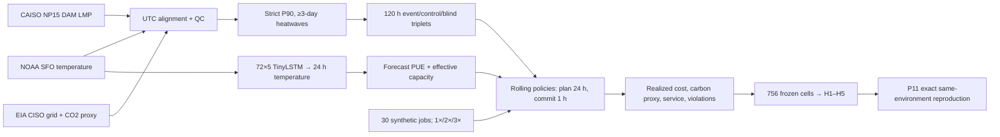

# HeatTrace Professor Quick Revision

**Scope:** HeatTrace v1 through P11. Days 15–21 are unexecuted future work.  
**One-line truth:** HeatTrace is a reproducible three-event case study showing that complete historical heatwave windows can expose simulated thermal-feasibility and equal-service policy differences that selected ordinary/event-blind windows miss—but not universally, and without proving a superior scheduler.

## One-page architecture

Execution rule: choose windows without scheduler outcomes; use forecasts for deployable decisions; commit only the next hour; score against realized data; compare cost/carbon only under equal completed service.

## Essential equations

\[
PUE(T)=\min(1.20+s\max(T-22,0),PUE_{max})
\]

Low: `s=0.010`, max 1.45; medium: `s=0.020`, max 1.70; high: `s=0.035`, max 2.00. Medium is primary; high was not in confirmation.

\[
P_{facility}=P_{IT}PUE,quad P_{cool}=P_{IT}(PUE-1),quad
C_{eff}=\min(500,600/PUE)
\]

\[
Cost=\sum_t E^{facility}_t\frac{LMP_t}{1000},\qquad
CarbonProxy=\sum_t E^{facility}_t\frac{I_t}{1000}
\]

\[
r=PUE^{realized}-PUE^{forecast},\quad
m=\max(0,Q_{0.90}^{higher}(r)),\quad
PUE^{safe}=\min(PUE_{max},PUE^{forecast}+m)
\]

Calibrated margin: `0.015999984741210893`; fixed comparator: `0.10`.

Example at 32°C, medium: PUE 1.40; capacity `600/1.40=428.57 kW`; 100 kW IT consumes 140 kW facility and 40 kW cooling overhead.

## Dataset definitions

| Dataset | HeatTrace signal | Exact interpretation | Important limitation |
|---|---|---|---|
| NOAA GHCNh | SFO `USW00023234` hourly temperature/local daily maxima | QC-filtered weather; California local days | One airport proxy |
| CAISO OASIS | DAM total LMP at `TH_NP15_GEN-APND` | USD/MWh at NP15 | Day-ahead, one node |
| EIA-930 CISO | Demand and net generation | Hour-ending values shifted to interval start | Quality flags retained |
| EIA CISO workbook | Generated-electricity CO2 intensity | lb/kWh × 453.59237 → g/kWh | Production average, not marginal/avoided emissions |

Canonical keys are timezone-aware UTC interval starts. Local-day conversion handles 23/24/25-hour daylight-saving days.

## Events and phases

Rule: pooled Jun–Sep 2022–2025 SFO daily maxima; linear P90 = **25.60°C**; strict `Tmax > 25.60`; at least three consecutive days.

| Event | Dates | Peak | Role |
|---|---|---|---|
| `HW_20220620` | 20–22 Jun 2022 | 36.7°C | CONF_1 |
| `HW_20220904` | 4–8 Sep 2022 | 35.6°C | CONF_2 |
| `HW_20220922` | 22–24 Sep 2022 | 28.3°C | CONF_3 |
| `HW_20240702` | 2–4 Jul 2024 | 31.1°C | Development only |

Phase labels: day before event = onset; hottest event day = peak; other event days = sustained; day after = recovery. P7 restored these via a sidecar after P6 collapsed them, but no confirmed phase-specific scheduler analysis exists.

## TinyLSTM essentials

- Input `[batch,72,5]`: standardized temperature; sin/cos hour; sin/cos day-of-year.
- One LSTM layer, hidden 32; dropout 0.1; linear projection to 24 temperatures.
- Training Jan–Apr 2022; validation May; calibration 1–16 Jun.
- SmoothL1, AdamW 0.001, batch 64, up to 50 epochs, patience 5.
- Validation: LSTM RMSE **2.0739°C**, previous-day **2.3297°C**.
- Development heatwave: LSTM RMSE **5.8075°C**, previous-day **3.6948°C**; LSTM extreme-underprediction MAE **6.8661°C**.
- Conclusion: validation win, poor extreme-event generalization; no proof of forecast-caused scheduling regret.

## Scheduling-policy comparison

| Policy | What it minimizes/uses | Temperature/capacity knowledge | Confirmed interpretation |
|---|---|---|---|
| ASAP | Earliest feasible hour | None | Earlier baseline only |
| Cost-first | Raw forecast USD/MWh | Nominal capacity | Earlier P4/P5 family |
| Carbon-first | Raw forecast gCO2/kWh | Nominal capacity | Earlier P4/P5 family/base objective |
| Balanced | 0.5 normalized price + 0.5 carbon | Nominal | Earlier P4/P5 family |
| DRO-inspired | Balanced + quantile penalty | Residual heuristic | Not formal DRO |
| Static unaware | Cost/carbon-first | No thermal state; 500 kW | Primary static comparator |
| Capacity-aware | Same objective | Forecast effective capacity | No boundary or violation improvement over static in H2 |
| Full thermal-aware | Price/carbon × forecast PUE | Forecast PUE + capacity | Some violation reduction; no boundary recovery |
| HeatGuard calibrated | Thermal-aware with margin 0.016 | Safe PUE/capacity | No superiority |
| HeatGuard fixed | Thermal-aware with margin 0.10 | More conservative | Helped CONF_1 violation hours only |
| Hindsight oracle | Realized market/PUE/capacity | Perfect future; non-deployable | Reference only; unequal-service rows rejected |

All frozen deployable policies plan 24 hours and commit only offset zero each hour.

## Frozen experiment and 756 cells

- Three confirmatory event triplets; contexts: heatwave, matched control, event blind.
- Facilities: energy-only and power-capped; curves: low/medium; loads: 1×/2×/3×; seeds: two.
- Carbon-first is the confirmatory objective.
- `432 core + 216 blind + 72 HeatGuard + 36 oracle = 756`.
- Scientific independent event count is **3**, not 756.

## Five hypothesis verdicts

| Hypothesis | Verdict | Key values | Correct interpretation |
|---|---|---|---|
| H1 static feasibility | **Supported, narrow** | Event effects `−0.5×, −0.5×, 0.0×`; median −0.5× | Medium curve, coarse `{1,2,3}×` grid; low-curve sensitivity weak |
| H2 awareness recovery | **Partially supported** | Boundary recovery 0/2; full-thermal violation reduction 2/2 applicable | OR-rule satisfied only by fewer violation hours; feasibility not restored |
| H3 blind understatement | **Partially supported** | CONF_1 `24/36 vs 0/36` (control also 24/36); CONF_2 `24/36 vs 0/36` (control 0); CONF_3 all 0; 48 tie→non-tie; 0 reversals | Separation, not different winner or carbon reduction |
| H4 forecast mechanism | **Not estimable** | No controlled forecast arm; no allocation vectors | Accuracy cannot establish causal regret |
| H5 HeatGuard | **Not supported** | Calibrated beat both comparators in 0/3 | No superiority or formal safety claim |

## Key verified numbers

- Workload: 30 jobs, 101 base slot-hours, 4,522.74 kWh; 10 preemptible, 20 non-preemptible.
- H3 primary equal-service `capacity-aware − full-thermal` gaps:
  - CONF_1: cost −$20.96/−$41.92/−$56.92; carbon proxy −80.24/−160.48/−236.79 kg for 1×/2×/3×.
  - CONF_2: cost −$188.38/−$376.76/−$371.14; carbon proxy −20.64/−41.28/−66.68 kg.
  - CONF_3: zero at all loads.
- HeatGuard 3× violation hours, calibrated/fixed/full thermal:
  - CONF_1: `1.0 / 0.0 / 1.0`.
  - CONF_2: `0.5 / 0.5 / 0.5`.
  - CONF_3: `0 / 0 / 0`.
- Ten oracle pairwise comparisons rejected for unequal service (one oracle seed completed 291/303 slots).
- P11: 756 successes; zero differences across 44 scientific columns; deterministic tables/figures matched; 54/54 archived artifacts verified.

## Major limitations

1. Three historical events; repeated runs are not independent events.
2. Controls are June 2024 while confirmatory heatwaves are 2022: year/season confounding.
3. Simulated PUE/capacity; no facility telemetry, humidity, or thermal inertia.
4. Synthetic jobs and a coarse workload grid.
5. Production-average carbon proxy, not marginal/avoided emissions.
6. CONF_1 control separates as much as its heatwave; CONF_3 is null; no strict reversals.
7. No controlled forecast substitution or phase-level confirmed outcomes.
8. P11 is same-environment reproduction, not clean-checkout/raw-data independent reproduction.

## What to say—and not say

**Say:** “Complete heatwave windows exposed modeled feasibility and equal-service policy separation in two of three cases.”

**Do not say:** “Heatwaves generally cause failures,” “HeatGuard is superior,” “we implemented Ruparel's DRO,” “TinyLSTM caused regret,” “blind testing chose the wrong scheduler,” or “our carbon values are avoided emissions.”

## Most likely professor questions

1. **What is the contribution?** A provenance-locked historical heatwave benchmark methodology with transparent thermal capacity and mixed/null confirmatory results.
2. **How does it differ from Ruparel?** HeatTrace is single-region and heuristic; no formal DRO/CVaR/Benders/battery/renewables.
3. **Why does heat reduce capacity?** Fixed facility power is shared by IT and cooling; higher PUE means fewer kW remain for IT.
4. **Why use 120 hours?** Preserve complete three- or five-day events with equal-duration comparisons; three-day events receive 24-hour context on each side.
5. **Why weather-only detection?** Avoid scheduler-outcome leakage.
6. **Why are controls problematic?** They are ordinary but from June 2024, not the event year/regime.
7. **Why did LSTM fail on the heatwave?** Distribution shift/extreme behavior differed from ordinary validation; evidence shows the error but not a single proven cause.
8. **Why didn't capacity-aware beat static?** Forecast capacity constraints did not change the greedy choices enough in the tested cases; identical or similar allocations can yield identical outcomes.
9. **Why can full thermal have more cost/carbon?** PUE-scaled scores and capacity move jobs away from nominally best market hours.
10. **Why did fixed HeatGuard help more than calibrated in CONF_1?** 0.10 was much more conservative than 0.016 and altered capacity/planning enough to avoid violations there.
11. **What is equal-service fairness?** A policy cannot earn lower cost/carbon credit by failing to complete the work.
12. **What does zero reversal mean?** Blind windows tied policies; heatwaves separated them, but the blind window never preferred the opposite policy.
13. **Why is H2 only partial?** The preregistered OR-rule allowed violation reduction, but no tested feasibility recovery occurred.
14. **Why is H4 not estimable?** Forecast source was not experimentally manipulated with all other factors held fixed.
15. **What would you do next?** Run ordinary-window distributions and same-scheduler TinyLSTM/persistence/oracle arms with hourly allocations, then replicate on more events.

## Two-minute explanation

HeatTrace asks whether carbon-aware cloud schedulers are evaluated fairly when extreme heat changes cooling overhead and available computing capacity. We align SFO temperature from NOAA, day-ahead NP15 electricity prices from CAISO, and an EIA production-average carbon-intensity proxy. Heatwaves are detected from weather alone using a strict 90th-percentile threshold for at least three consecutive days. A TinyLSTM forecasts 24 hours of temperature from 72 hours of history. Forecast temperature enters a transparent PUE model, and under a 600 kW facility cap higher PUE reduces the available IT capacity below 500 kW.

We schedule deterministic synthetic deadline-constrained jobs using static, capacity-aware, full thermal-aware, HeatGuard calibrated/fixed, and hindsight-oracle policies. Every deployable policy replans over 24 hours but commits only the next hour. The frozen confirmation had three heatwave/control/blind triplets and 756 simulation cells, but only three independent historical events.

Static feasibility was 0.5× lower in two events and unchanged in the third. Complete heatwave windows exposed policy differences that selected blind windows missed in two events, but there were no strict ranking reversals, one matched control separated just as much, and the third event was null. Full thermal awareness reduced some violation hours without restoring feasibility. Calibrated HeatGuard was not superior, and the study cannot attribute scheduling outcomes causally to forecast error. P11 reran all 756 cells with exact agreement in every scientific column. So the defensible contribution is a reproducible benchmark-validity case study with mixed results—not a superior scheduling algorithm and not a complete implementation of Ruparel's DRO framework.

## Code map for oral defense

- NOAA/QC: `src/heattrace/ingest/noaa.py:99-435`
- Alignment: `src/heattrace/process/alignment.py:52-482`
- Events/phases: `src/heattrace/process/events.py:111-365`
- Windows/overlay: `src/heattrace/process/p6_event_bundle.py:88-161,617-914,1636-1825`
- Forecast features/model/train: `src/heattrace/forecast/dataset.py:269-384`; `tiny_lstm.py:115-165`; `train_temperature.py:69-207`
- Thermal equations: `src/heattrace/thermal/model.py:60-201`; facility states `thermal/facility.py:268-370`
- Earlier policies: `src/heattrace/policy/greedy.py:23-293`; heuristic `policy/robust.py:35-108`
- Frozen policies: `src/heattrace/thermal/policies.py:245-673`
- HeatGuard: `src/heattrace/forecast/calibration.py:92-147`; `thermal/heatguard.py:59-87,302-334`
- Rolling execution: `src/heattrace/experiments/p6_validity_runner.py:1301-1470`
- Scoring: `src/heattrace/thermal/metrics.py:18-205`
- H1–H5: `src/heattrace/evaluation/p6_validity.py:488-895`
