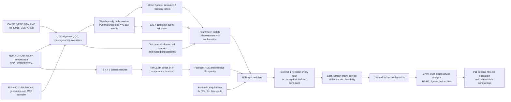

# HeatTrace Website and Professor-Presentation Source Package

**Evidence boundary:** HeatTrace v1 through P11 (Days 13–14), inspected on 2026-10-26 at repository `HEAD` `1114e5b`. Days 15–21 are plans, not results. This document is an evidence package for later website planning; it is not a website specification and contains no implementation prompt.

**Status vocabulary used below**

- **Implemented:** present in code and/or frozen artifacts.
- **Development:** exploratory work used to debug or shape the final study; not confirmatory evidence.
- **Confirmatory:** produced by the sealed three-event P8 matrix and frozen P9/P10 analysis.
- **Reproduced:** independently regenerated within the same machine/repository lineage in P11.
- **Planned:** proposed for Days 15–21 and not executed in v1.

**Important record correction:** `docs/p11_v1_reproduction_report.md` still prints `23/36` for CONF_2 H3, but the corrected current result table and P10 report give **24/36** (`data/results/p6_h1_h5_assessment.csv`, `data/results/p6_t3_equal_service_gaps.csv`, `docs/p6_validity_report.md`). The current P11 report now correctly states that all 756 cells were rerun; older audit prose describing a contradictory “not rerun” sentence is historical and no longer matches the current file after commit `1114e5b`.

---

# PART A — Research Overview

## A1. Project title and one-sentence description

**Repository title:** **HeatTrace**.

**Current research title:** **HeatTrace v1: Evaluating Thermal Feasibility and Capacity Awareness under Historical Grid Stress** (`docs/heattrace_v1_preliminary_manuscript.md`).

**One-sentence description:** HeatTrace is a reproducible research prototype that combines historical CAISO-region weather and grid signals with simulated data-center cooling/capacity behavior, synthetic deadline-constrained workloads, causal temperature forecasting, and several schedulers to test whether complete heatwave windows expose feasibility or policy differences that ordinary or event-blind windows miss.

## A2. Motivation and problem statement

Carbon-aware schedulers commonly shift flexible computing toward hours with cheaper or cleaner electricity. That logic can overlook a second heat-related mechanism: hotter ambient air increases modeled cooling overhead, raises facility energy per unit of IT work, and—under a fixed facility power cap—reduces the power available for computation. A scheduler evaluated only on ordinary or arbitrarily chosen short windows may therefore appear feasible or indistinguishable from alternatives while a complete multi-day heatwave reveals different constraints.

HeatTrace asks a bounded question: **within a frozen CAISO historical case series, simulated facility model, and synthetic workload model, do complete heatwave windows change tested feasibility or policy-separation conclusions relative to matched controls and event-blind windows?** This is a benchmark-validity and sensitivity question, not a claim about observed data-center failures.

Primary evidence: `docs/p6_frozen_protocol.md`, `docs/p6_validity_report.md`, `docs/heattrace_v1_preliminary_manuscript.md`.

## A3. Research objectives

1. Build a provenance-tracked hourly data pipeline for NOAA temperature, CAISO day-ahead electricity price, and EIA-930 grid signals.
2. Detect multi-day heatwaves from weather alone, retain onset/peak/sustained/recovery labels, and construct outcome-blind matched-control and event-blind comparisons.
3. Model a transparent temperature-to-PUE-to-effective-capacity mechanism under both energy-only and fixed-facility-power conditions.
4. Evaluate static, capacity-aware, thermal-aware, HeatGuard-margin, and hindsight-oracle scheduling under identical jobs, deadlines, and service-accounting rules.
5. Compare complete heatwaves with matched controls and event-blind windows at the historical-event level, keeping seeds and configuration cells as within-event repetitions rather than independent events.
6. Test whether a small TinyLSTM forecast passes a frozen validation gate, while avoiding any unsupported claim that forecast errors caused scheduling regret.
7. Reproduce and archive the frozen 756-cell v1 result set.

## A4. Reference paper: verified bibliographic record

**Hardik Ruparel. “Carbon-aware scheduling and distributionally robust optimization for cloud systems: forecasting, battery storage, and adaptive ambiguity refinement.” _Journal of Cloud Computing_, volume 15, article 84 (2026). Published 5 June 2026. DOI: [10.1186/s13677-026-00904-7](https://doi.org/10.1186/s13677-026-00904-7).**

The publisher describes a geo-distributed, multi-objective distributionally robust optimization framework involving price/carbon/renewable forecasts, moment- and Wasserstein-based ambiguity sets, CVaR, Benders decomposition, battery constraints, adaptive ambiguity refinement, and six benchmark policies. Repository reference: `docs/heattrace-heatguard-14-day-plan.md`. External bibliographic verification: [Springer Nature article page](https://link.springer.com/article/10.1186/s13677-026-00904-7).

HeatTrace is **inspired by the problem setting**, especially forecast-aware carbon scheduling under uncertainty. It is **not** a reproduction of Ruparel’s optimizer or full energy system.

## A5. Gaps targeted by HeatTrace

- Extreme-temperature episodes are treated as first-class evaluation windows rather than background variation.
- Ambient temperature is connected explicitly to stylized PUE and IT-capacity derating.
- Complete heatwave events are compared with outcome-blind controls and equal-duration event-blind windows.
- The evaluation preserves positive, null, and negative findings at event level.
- Run identities, input hashes, failure rows, equal-service checks, and a second same-environment execution are preserved for reproducibility.

These are gaps relative to the project’s chosen reference framing; **a full novelty claim against the broader sustainable-computing literature has not been established** because a systematic related-work comparison is unfinished.

## A6. What HeatTrace adds relative to the reference paper

HeatTrace adds a historical heatwave-event evaluation layer, a transparent temperature-dependent facility-capacity model, phase annotations, outcome-blind triplet construction, and a provenance-locked case-series protocol. Conversely, it omits Ruparel’s geo-distributed placement, formal DRO/DRCC/CVaR optimization, Benders decomposition, battery model, renewable model, adaptive ambiguity set, and full multi-region price/carbon/renewable forecasting.

## A7. Strongest defensible contribution

> In a provenance-locked three-event CAISO case series using simulated power-capped facilities and synthetic workloads, complete heatwave windows exposed equal-service cost and production-based carbon-proxy policy separations that frozen event-blind windows missed in two events, while the third event was null. Static scheduling also showed a 0.5× lower grid-bounded feasibility envelope in two events. The study found no strict ranking reversals, no HeatGuard advantage, and cannot attribute observed differences to forecast-caused scheduling regret.

Source: `docs/p6_validity_report.md`, especially the frozen claim in Section 11; numerical tables in `data/results/p6_h1_h5_assessment.csv`, `p6_t2_event_feasibility.csv`, and `p6_t3_equal_service_gaps.csv`.

## A8. Publication readiness

**Assessment: LIMITED RESULT; suitable for a workshop/short-paper submission only with careful framing.** The strongest paper is a reproducible benchmark-methodology and mixed-results paper, not an algorithm-superiority paper. Publication blockers include a three-event scope, simulated facilities, synthetic jobs, production-average carbon proxies, no exact dependency lock, no clean-checkout full simulation, no raw-source dataset rebuild, and an unfinished broader related-work/novelty assessment. P11 materially improves artifact readiness but does not make the work independently reproducible by a third party from a bare checkout.

Sources: `docs/p6_validity_report.md`, `docs/p11_final_results_audit.md`, `docs/heattrace_remaining_work.md`, `data/archive/heattrace_v1_d5b3c86/archive_manifest.json`.

---

# PART B — Complete Architecture

## B1. Implemented end-to-end pipeline



## B2. Subsystem inventory

| Subsystem | Purpose and algorithm | Inputs → outputs | Key implementation | Implemented vs planned / assumptions |
|---|---|---|---|---|
| NOAA ingestion | Download/cache GHCNh, parse quality-controlled hourly observations, resolve duplicates, aggregate by UTC hour and local day. | NOAA PSV → hourly °C and daily maxima | `src/heattrace/ingest/noaa.py`, `src/heattrace/process/alignment.py` | Implemented. Raw files are local/Git-ignored. SFO is the actual station used. |
| CAISO ingestion | Retrieve day-ahead hourly total LMP for NP15 with retry, throttle, ZIP validation, and cache. | OASIS PRC_LMP → USD/MWh | `src/heattrace/ingest/caiso.py`, `configs/sources.yaml` | Implemented. Historical SingleZip access has a rolling-window limitation. |
| EIA ingestion and carbon | Read EIA-930 demand/net generation and the official CISO workbook’s generated-electricity CO2 intensity; shift hour-ending timestamps back one hour. | EIA API/workbook → MW/MWh and gCO2/kWh | `src/heattrace/ingest/eia.py`, `docs/carbon_method.md` | Implemented. Carbon is production-average, carries EIA issue flags, and is not marginal/avoided emissions. |
| Alignment/QC | Form one aware-UTC, interval-start hourly table; enforce completeness, monotonicity, uniqueness, units, and source provenance. | Source tables → canonical aligned parquet/manifests | `src/heattrace/process/alignment.py`, `docs/contracts.md`, `docs/p2_alignment.md` | Implemented. |
| Heatwave detection | Pool Jun–Sep daily maxima across 2022–2025; compute empirical P90 using linear interpolation; detect strict `Tmax > P90` runs of ≥3 consecutive days. | Daily maxima → event catalogue | `src/heattrace/process/events.py`, `configs/sources.yaml` | Implemented: threshold 25.60°C; four events. |
| Phase labeling | Label the local day before an event onset, hottest event day peak (earliest tie), other event days sustained, and following day recovery; expand to hours. | Event catalogue → hourly phase labels | `src/heattrace/process/events.py`, `data/benchmarks/p7_phase_label_overlay.parquet` | Labels implemented and repaired via P7 sidecar. Phase-specific scheduler outcome analysis was not implemented. |
| Control construction | Slide summer windows, exclude heatwave/buffer overlap, missing NOAA days and internal ≥3-day heat runs; match by weather/calendar rules only. | Events + daily weather → control catalogue | `src/heattrace/process/controls.py`, `data/events/control_catalogue_v0.parquet` | Implemented. Confirmatory controls are June 2024, a confounding limitation for 2022 heatwaves. |
| Event-blind selection | Construct complete 120h candidates with coverage and event/buffer separation, select deterministically before scheduler outcomes. | Aligned data + events/controls → blind pool/index | `src/heattrace/process/p6_event_bundle.py`, `data/benchmarks/p6_event_blind_pool.csv` | Implemented and frozen. “Blind” means blind to event/scheduler outcomes, not randomly sampled population controls. |
| Forecasting | Build causal 72-hour histories with standardized temperature and cyclical time features; one-layer LSTM maps 72×5 directly to 24 temperatures. | NOAA history → 24h temperature forecast | `src/heattrace/forecast/dataset.py`, `tiny_lstm.py`, `train_temperature.py`, model artifacts | Implemented. Confirmatory results lack controlled forecast arms. |
| Workload simulation | Deterministically generate 30 relative-offset jobs; replicate rows for 1×/2×/3× loads and two seeds. | Seed + horizon → jobs | `src/heattrace/workload/generator.py`, `scaling.py`, `data/workloads/workload_trace_v0.parquet` | Implemented; synthetic rather than production traces. |
| Facility model | Map ambient temperature to PUE, facility energy and power; optionally derate IT capacity under a 600 kW facility cap. | Temperature + IT schedule → PUE/capacity/facility metrics | `src/heattrace/thermal/model.py`, `facility.py`, `metrics.py`, `configs/p6_thermal.yaml` | Implemented as controlled sensitivity, not calibrated telemetry. |
| Scheduling | Greedy job ordering and hourly scoring; capacity repair, PUE-adjusted objectives, safety margins, rolling state and deadline handling. | Jobs + forecasts + constraints → allocations | `src/heattrace/thermal/policies.py`, `scheduler.py`, `heatguard.py` | Implemented heuristics, not formal optimization/DRO. |
| Experiment execution | Enumerate stable run IDs, verify frozen hashes and identities, execute each cell, preserve success/failure rows, checkpoints and log. | Frozen config/triplets/models → 756-row parquet | `src/heattrace/experiments/p6_validity_runner.py` | Implemented; 756/756 success in canonical and P11 rerun. |
| Analysis | Aggregate seeds within cells/events; enforce equal service; compute feasibility boundaries, pairwise gaps and H1–H5 verdicts. | Run parquet → T1–T4, figures, report | `src/heattrace/evaluation/p6_validity.py`, `data/results/p6_*` | Implemented at event/context level; no phase-level allocations or forecast counterfactuals. |

## B3. Key equations

Heatwave day and event:

\[
\text{hot day}(d)=\mathbf{1}[T_{\max,d}>Q_{0.90}],\qquad \text{event}=\text{run of at least 3 hot days}.
\]

Production-average carbon conversion:

\[
I_{g/kWh}=I_{lb/kWh}\times 453.59237.
\]

Temperature-dependent PUE:

\[
PUE_t=\min\left(PUE_0+s\max(T_t-22,0),PUE_{max}\right).
\]

Facility power, energy, cooling, and effective IT capacity:

\[
P^{facility}_t=P^{IT}_tPUE_t,\quad E^{facility}_t=E^{IT}_tPUE_t,\quad E^{cool}_t=E^{IT}_t(PUE_t-1),
\]

\[
P_{cap}=500\times1.20=600\text{ kW},\qquad C^{eff}_t=\min\left(500,\frac{600}{PUE_t}\right).
\]

Cost and carbon proxy:

\[
Cost=\sum_t\frac{E^{facility}_t\,LMP_t}{1000},\qquad CarbonProxy=\sum_t\frac{E^{facility}_t\,I_t}{1000}.
\]

Grid-bounded feasibility effect:

\[
\Delta\lambda_i^*=\lambda^*_{heatwave,i}-\lambda^*_{control,i},
\]

where \(\lambda^*\) is the largest tested workload level on the frozen grid. Analysis tables interpolate a 2.5× boundary between the tested 2× feasible and 3× infeasible points; it is still a coarse grid-bounded summary, not a continuously measured threshold.

HeatGuard margin:

\[
r_{i,h}=PUE^{realized}_{i,h}-PUE^{forecast}_{i,h},\quad m=\max(0,Q^{higher}_{0.90}(r)),
\]

\[
PUE^{safe}_t=\min(PUE_{max},PUE^{forecast}_t+m),\qquad C^{safe}_t=\min\left(500,\frac{600}{PUE^{safe}_t}\right).
\]

The frozen calibrated margin is `0.015999984741210893`; fixed comparator margin is `0.10`.

---

# PART C — Research Methodology

## C1. Data and study region

| Signal | Exact source and scope | Units / semantics | Evidence |
|---|---|---|---|
| Weather | NOAA GHCNh station `USW00023234`, San Francisco International Airport | °C; local-day classification in `America/Los_Angeles`; canonical hourly timestamps are UTC interval starts | `configs/sources.yaml`, `src/heattrace/ingest/noaa.py`, `data/events/heatwave_events_v0.parquet` |
| Electricity price | CAISO OASIS day-ahead market total LMP, node `TH_NP15_GEN-APND` | USD/MWh, hourly | `configs/sources.yaml`, `docs/contracts.md`, `src/heattrace/ingest/caiso.py` |
| Demand / generation | EIA-930 balancing authority `CISO` | MW/MWh; EIA hour-ending values converted to interval start by subtracting one hour | `src/heattrace/ingest/eia.py`, `docs/p2_alignment.md` |
| Carbon proxy | EIA CISO workbook field `CO2 Emissions Intensity for Generated Electricity` | lb/kWh × 453.59237 = g/kWh | `docs/carbon_method.md` |

All carbon rows retain quality flags where present. The metric is average production intensity, not a marginal-emissions estimate.

## C2. Heatwave rule and catalogue

- Pool: June–September daily maxima, 2022–2025.
- Threshold: empirical 90th percentile, linear interpolation, **25.60°C**.
- Qualifying day: daily maximum **strictly greater than** 25.60°C.
- Event: at least **3 consecutive** qualifying local days.
- Detected events: four total; 2024 event used for development, three 2022 events reserved for confirmation.

Source: `src/heattrace/process/events.py`, `data/events/heatwave_events_v0.parquet`.

## C3. Event, control and event-blind selection

Each evaluation context is exactly 120 hours. A raw 72-hour event gets 24 hours of context before and after; the 120-hour event needs no padding. Raw events are never truncated (`compute_event_evaluation_window` in `src/heattrace/process/p6_event_bundle.py`).

Matched controls are outcome-blind: candidate windows are screened by weather coverage, heatwave/buffer overlap, and internal heat-run rules; no price, carbon, demand or scheduler outcome is used for selection. Confirmatory controls are fixed June 2024 windows. Event-blind windows are also frozen 120-hour windows with complete canonical signals and separation buffers.

| Triplet | 120h heatwave evaluation interval `[start,end)` UTC | Matched control interval UTC | Event-blind interval UTC |
|---|---|---|---|
| Development | `HW_20240702`: 2024-07-01 07:00 → 2024-07-06 07:00 | `CTRL_20240605`: 2024-06-05 07:00 → 2024-06-10 07:00 | `BLIND_ef75b17921d7`: 2024-09-19 07:00 → 2024-09-24 07:00 |
| CONF_1 | `HW_20220620`: 2022-06-19 07:00 → 2022-06-24 07:00 | `CTRL_20240610`: 2024-06-10 07:00 → 2024-06-15 07:00 | `BLIND_9511c8fdb71a`: 2024-08-03 07:00 → 2024-08-08 07:00 |
| CONF_2 | `HW_20220904`: 2022-09-04 07:00 → 2022-09-09 07:00 | `CTRL_20240615`: 2024-06-15 07:00 → 2024-06-20 07:00 | `BLIND_ec5ea1727f70`: 2024-09-03 07:00 → 2024-09-08 07:00 |
| CONF_3 | `HW_20220922`: 2022-09-21 07:00 → 2022-09-26 07:00 | `CTRL_20240620`: 2024-06-20 07:00 → 2024-06-25 07:00 | `BLIND_0a5ab2aec053`: 2024-07-27 07:00 → 2024-08-01 07:00 |

Source: `data/benchmarks/p6_event_control_index.csv`.

## C4. Synthetic workloads, deadlines and capacity

The base trace contains **30 jobs**, **101 processing slot-hours**, and **4,522.74 kWh**. Jobs have relative arrivals from 0–113 hours, integer processing requirements from 1–6 hours, power draws sampled from 15–75 kW, maximum parallelism in `{1,2,4}`, priority 1–5, and a preemptibility flag (10 preemptible, 20 non-preemptible). Deadlines are exclusive and derived from arrival + processing + 1–24 hours of sampled slack, clipped to the 120-hour horizon.

Confirmation scales the deterministic trace to 1×/2×/3× load and uses seeds `20261016` and `20261017`. Every policy sees identical jobs within a cell. Preemptible work can occupy non-contiguous slots; non-preemptible work requires a contiguous block. Hourly nominal limits are 500 kW and 16 concurrent distinct jobs. Energy and processing work cannot be silently dropped.

Sources: `src/heattrace/workload/generator.py`, `src/heattrace/workload/scaling.py`, `docs/p4_scheduling_metrics.md`, `data/workloads/workload_trace_v0.parquet`.

## C5. Facility models and PUE

- **Energy-only:** IT capacity remains nominal at 500 kW. Temperature changes PUE, facility energy, cost and carbon proxy, but does not derate the scheduling capacity.
- **Power-capped:** the fixed facility cap is 600 kW. Effective IT capacity falls as PUE rises: `min(500, 600/PUE)`.
- **Frozen confirmation curves:** low (`s=0.010/°C`, max 1.45) and medium (`s=0.020/°C`, max 1.70). High (`s=0.035/°C`, max 2.00) exists as an earlier sensitivity but is not in the confirmatory matrix.

Source: `configs/p6_thermal.yaml`, `docs/p6_thermal_method.md`.

## C6. TinyLSTM architecture and gate

Input is `[batch,72,5]`: standardized temperature, sine/cosine hour-of-day, and sine/cosine day-of-year. A one-layer unidirectional LSTM with hidden size 32 feeds dropout 0.1 and a linear 32→24 head for a direct 24-hour forecast. Training uses only the frozen training interval, CPU AdamW (`lr=0.001`), SmoothL1 loss, batch size 64, seed `20261016`, at most 50 epochs, and early stopping patience 5. Baselines are last observation, same hour previous day, and EWMA(0.20).

Frozen splits: training 2022-01-01 to 2022-05-01; validation May 2022; calibration reservation 2022-06-01 to 2022-06-16, all half-open UTC intervals.

Source: `configs/p6_validity.yaml`, `src/heattrace/forecast/dataset.py`, `src/heattrace/forecast/tiny_lstm.py`.

## C7. Scheduler baselines and HeatGuard

**Earlier P4/P5 policies:** ASAP baseline, cost-first, carbon-first, balanced 50/50 normalized cost-carbon, and a risk-penalized “DRO-inspired” heuristic. The last is explicitly not formal DRO (`src/heattrace/policy/`).

**Frozen P8 core policies:**

- `static_unaware`: carbon-first greedy scheduling using nominal capacity, with no temperature/PUE/capacity input.
- `capacity_aware`: same objective with forecast-derived effective-capacity repair.
- `full_thermal_aware`: forecast-PUE-adjusted carbon/cost scoring plus forecast capacity.
- `heatguard_calibrated`: full-thermal planner using the calibrated PUE residual margin ≈0.016.
- `heatguard_fixed`: identical mechanism with margin 0.10.
- `oracle_full_thermal_aware`: hindsight realized conditions; marked non-deployable.

All deployable thermal policies use a **24-hour rolling horizon**, **commit one hour**, then replan every hour. Only released jobs enter the planner; completed work is preserved; unfinished work carries forward. HeatGuard’s margin is a heuristic upper-PUE buffer, not a probabilistic safety guarantee.

Sources: `src/heattrace/thermal/policies.py`, `src/heattrace/thermal/heatguard.py`, `docs/p6_frozen_protocol.md`.

## C8. Frozen experiment matrix

- Core heatwave/control: 432 cells.
- Event-blind: 216 cells.
- HeatGuard comparators: 72 cells.
- Non-deployable oracle: 36 cells.
- **Total: 756 stable run IDs.**

Primary confirmatory condition is power-capped, medium thermal curve, carbon-first objective; the workload grid is 1×/2×/3× and seeds are aggregated before event-level contrasts. The historical event/triplet is the independent unit (`N=3`), not the 756 cells.

## C9. Illustrative numerical example

**The following job and market values are illustrative; the facility parameters and equations are implemented values.**

Suppose a forecast hour has ambient temperature 32°C under the medium curve, LMP $80/MWh, carbon intensity 250 g/kWh, and a candidate IT allocation of 450 kW for one hour.

1. `PUE = 1.20 + 0.020 × (32−22) = 1.40`.
2. Power-capped IT capacity is `600/1.40 = 428.57 kW`.
3. A static 450 kW allocation would draw `450 × 1.40 = 630 kW`, exceeding the 600 kW cap by **30 kW**.
4. Facility energy would be **630 kWh**, including `450 × (1.40−1) = 180 kWh` of modeled cooling/overhead energy.
5. Modeled hourly cost would be `630 × 80 / 1000 = $50.40`.
6. Modeled production-carbon proxy would be `630 × 250 / 1000 = 157.5 kg CO2`.
7. A capacity-aware planner must keep the committed IT allocation at or below 428.57 kW, move work within its arrival/deadline window, or record infeasibility.

This example explains the mechanism; it is not one of the reported empirical cells.

---

# PART D — Experimental Results

## D1. Confirmatory execution facts

| Result | Exact value | Status and interpretation | Source |
|---|---:|---|---|
| Confirmatory historical events | 3 | Frozen case series: CONF_1, CONF_2, CONF_3 | `configs/p6_validity.yaml` |
| Frozen run cells | 756 | 432 core + 216 blind + 72 comparators + 36 oracle | `data/results/p6_t1_cohort_provenance.csv` |
| Canonical successes / failures | 756 / 0 | Every enumerated cell has a successful result row | same |
| P11 rerun successes / failures | 756 / 0 | Second execution from zero checkpoint state | `docs/p11_v1_reproduction_report.md`, `data/results/p11_reproduction_comparison.json` |
| Scientific differences in P11 | 0 | All 44 actual non-operational columns matched after run-ID alignment | `docs/p11_v1_reproduction_report.md` |

Raw detected confirmatory events were `HW_20220620` (2022-06-20 07:00 to 2022-06-23 07:00 UTC), `HW_20220904` (2022-09-04 07:00 to 2022-09-09 07:00), and `HW_20220922` (2022-09-22 07:00 to 2022-09-25 07:00). The evaluated 120-hour intervals, which preserve complete events and add symmetric context to 72-hour events, are listed in Part C.

## D2. Feasibility envelope

Under the frozen primary power-capped/medium/carbon-first condition:

| Event | Static heatwave boundary | Static control boundary | Heatwave − control | Status | Interpretation and limitation |
|---|---:|---:|---:|---|---|
| CONF_1 | 2.5× | 3.0× | **−0.5×** | Confirmatory, reproduced | Lower grid-bounded static feasibility under heatwave; coarse tested grid and simulated facility. |
| CONF_2 | 2.5× | 3.0× | **−0.5×** | Confirmatory, reproduced | Same bounded effect. |
| CONF_3 | 3.0× | 3.0× | **0.0×** | Confirmatory, reproduced null | No detected feasibility loss. |

Low-curve sensitivity was weak: only one of three event effects was negative, with median 0.0×. Sources: `data/results/p6_t2_event_feasibility.csv`, `data/results/p6_h1_h5_assessment.csv`, `docs/p6_validity_report.md`.

## D3. Cost and production-carbon proxy differences among core policies

These are **equal-service pairwise gaps**, defined as policy A minus policy B, under power-capped/medium/carbon-first conditions and averaged across two seeds. They are policy separations, **not savings achieved by HeatTrace**.

`capacity_aware` and `static_unaware` tied exactly in every primary-condition comparison. Therefore the non-zero core contrast is capacity/static versus `full_thermal_aware`.

| Event/context | Workload | Cost gap: capacity − full thermal (USD) | Carbon-proxy gap: capacity − full thermal (kg CO2) | Interpretation |
|---|---:|---:|---:|---|
| CONF_1 heatwave | 1× | −20.9615 | −80.2420 | Capacity/static has lower reported cost and proxy carbon. |
| CONF_1 heatwave | 2× | −41.9231 | −160.4840 | Same direction. |
| CONF_1 heatwave | 3× | −56.9215 | −236.7887 | Same direction; compare only as equal completed work, not as “savings.” |
| CONF_1 control | 1× / 2× / 3× | −2.7883 / −5.5765 / −8.3648 | −7.0552 / −14.1103 / −21.1654 | The matched control also discriminates policies. |
| CONF_1 blind | 1× / 2× / 3× | 0 / 0 / 0 | 0 / 0 / 0 | Complete tie. |
| CONF_2 heatwave | 1× | −188.3812 | −20.6395 | Capacity/static has lower reported cost and proxy carbon. |
| CONF_2 heatwave | 2× | −376.7622 | −41.2789 | Same direction. |
| CONF_2 heatwave | 3× | −371.1362 | −66.6778 | Same direction. |
| CONF_2 control | 1× / 2× / 3× | 0 / 0 / 0 | 0 / 0 / 0 | Tie. |
| CONF_2 blind | 1× / 2× / 3× | 0 / 0 / 0 | 0 / 0 / 0 | Tie. |
| CONF_3 all contexts | 1× / 2× / 3× | 0 throughout | 0 throughout | Complete null event for core-policy separation. |

Source: `data/results/p6_t3_equal_service_gaps.csv`; underlying levels in `data/results/p6_event_level_metrics.csv`.

## D4. Heatwave versus event-blind and matched-control results

The H3 analysis counts non-zero cost and carbon-proxy policy contrasts across the broader frozen comparison table (36 comparisons per context/event), not just the nine core rows shown above.

| Event | Heatwave non-zero gaps | Blind non-zero gaps | Control non-zero gaps | Heatwave − blind count | Strict heatwave/blind reversals | Verdict |
|---|---:|---:|---:|---:|---:|---|
| CONF_1 | 24/36 | 0/36 | 24/36 | +24 | 0 | Heatwave differs from blind, but the ordinary control discriminates equally. |
| CONF_2 | 24/36 | 0/36 | 0/36 | +24 | 0 | Separation appears in heatwave only for this selected triplet. |
| CONF_3 | 0/36 | 0/36 | 0/36 | 0 | 0 | Null across all three contexts. |

Across all three events there were **48 tie-to-non-tie transitions** and **0 strict reversals across 108 heatwave-versus-blind core-policy transitions**. A separate eligibility summary reports 0/54 eligible strict pair reversals. These are compatible denominators for different transition subsets; neither supports “the blind benchmark chose the wrong scheduler.”

Source: `data/results/p6_h1_h5_assessment.csv`, `data/results/p6_t3_equal_service_gaps.csv`, `docs/p6_validity_report.md`.

## D5. TinyLSTM versus persistence

| Split/context | TinyLSTM RMSE (°C) | Best simple baseline | Baseline RMSE (°C) | Result status |
|---|---:|---|---:|---|
| Frozen validation | **2.0739** | Same-hour previous day | 2.3297 | Development/validation gate: TinyLSTM improves RMSE by **10.98%**. |
| Validation extreme underprediction | 3.4291 MAE | Same-hour previous day | **3.2155 MAE** | Extreme condition not improved; gate passed through overall-RMSE condition only. |
| Development heatwave | 5.8075 | Same-hour previous day | **3.6948** | TinyLSTM worse. |
| Development matched control | **1.8744** | Same-hour previous day | 2.5746 | TinyLSTM better. |
| Development event-blind | 3.0177 | Same-hour previous day | **1.8762** | TinyLSTM worse. |

This is forecast-accuracy evidence, not evidence of forecast-caused scheduler regret. Confirmation did not vary forecast source while holding scheduler and all other inputs fixed. Source: `data/results/p6_forecast_metrics.csv`, `data/results/p6_t4_forecast_evidence.csv`.

## D6. HeatGuard versus fixed-margin and deterministic baselines

At 3× load in primary heatwave conditions, mean violation hours were:

| Event | Calibrated HeatGuard | Fixed 0.10 margin | Deterministic full thermal (zero margin) | Result |
|---|---:|---:|---:|---|
| CONF_1 | 0.5 h | **0.0 h** | 0.5 h | Calibrated is worse than fixed and tied with deterministic. |
| CONF_2 | 0.5 h | 0.5 h | 0.5 h | Three-way tie. |
| CONF_3 | 0.0 h | 0.0 h | 0.0 h | Three-way tie. |

The event-level table reports calibrated totals of 1.0 h, 0.5 h, 0.0 h when aggregating the relevant workload comparisons; either view yields **0/3 events with advantage over both comparators**. Verdict: **not supported**. Source: `data/results/p6_event_level_metrics.csv`, `data/results/p6_h1_h5_assessment.csv`, `data/results/p6_t2_event_feasibility.csv`.

## D7. Capacity-aware and full-thermal results

- Exact `capacity_aware` was identical to `static_unaware`: **0.0× boundary recovery and 0.0 h violation reduction**.
- `full_thermal_aware` reduced 3× heatwave violation hours by **1.0 h in CONF_1** (1.5→0.5 h) and **0.5 h in CONF_2** (1.0→0.5 h).
- It did **not** recover a tested feasibility boundary and made the CONF_1 boundary **0.5× lower** than static/capacity-aware.
- CONF_3 had no prerequisite static loss, so recovery is not applicable.

This is mixed evidence, not proof that thermal awareness restores feasibility.

## D8. Day 8 development versus final confirmation

| Dimension | Day 8 development | Frozen confirmation |
|---|---|---|
| Historical scope | One July 2024 triplet | Three sealed 2022 triplets |
| Static feasibility | No boundary loss through 3× | −0.5× in 2/3 events; one null |
| Policy separation | Event separation while blind tied | Repeated in 2/3; CONF_3 null; CONF_1 control also discriminated |
| Forecast | TinyLSTM mixed and worse than day-lag on heatwave/blind | No causal forecast intervention, so mechanism unestimable |
| HeatGuard | No margin advantage; zero violations in pilot | No advantage in 0/3 events |
| Evidentiary role | Exploratory development | Governs v1 claims |

Sources: `docs/p6_pilot_review.md`, `docs/p6_validity_report.md`.

## D9. Equal-service and oracle accounting

There were **540** seed-aggregated pairwise contrasts; **530** passed equal-service checks and **10** were rejected. All ten rejections involved the non-deployable hindsight oracle in control contexts. Under seed `20261016`, the oracle completed 291 of 303 demanded slots, leaving 12 unfinished; deployable policies completed all demanded work. No cost/carbon conclusion should use the rejected pairs.

Source: `data/results/p6_analysis_manifest.json`, `docs/p6_validity_report.md`.

---

# PART E — Research Hypotheses

| Hypothesis | Goal | Experiment | Result | Verdict | Limitations |
|---|---|---|---|---|---|
| H1 — Static feasibility | Test whether static scheduling has lower tested maximum feasible load in heatwaves than matched controls. | Power-capped, medium curve, carbon-first, three paired events; `Δλ*=HW−CTRL`; support requires ≥2/3 negative and negative median. | −0.5×, −0.5×, 0.0×; median −0.5×. | **SUPPORTED** | Bounded rule on a coarse grid, N=3, simulated facility; low-curve sensitivity only 1/3 negative. |
| H2 — Capacity-awareness recovery | Test whether capacity/thermal awareness raises tested feasible load or reduces violations during heatwaves. | Compare static, exact capacity-aware and full-thermal policies in applicable event cells. | Exact capacity-aware: 0 recovery, 0 h reduction. Full thermal: no recovery; 1.0 h and 0.5 h violation reductions; CONF_1 boundary worsened −0.5×. | **PARTIALLY SUPPORTED** | Support comes only from the frozen OR rule’s violation branch; mixed across policies/outcomes; CONF_3 N/A. |
| H3 — Event-blind understatement | Test whether complete-event evaluation changes feasibility or ranking conclusions relative to blind equal-duration windows. | Count equal-service non-zero gaps and rank transitions by event/context. | HW/blind gaps: 24/36 vs 0/36 in CONF_1 and CONF_2; 0/36 vs 0/36 in CONF_3; 48 tie→non-tie; 0 strict reversals. | **PARTIALLY SUPPORTED** | CONF_1 control also has 24/36; no strict reversal; selected blind windows do not represent all ordinary periods. |
| H4 — Forecast mechanism attribution | Determine whether changing only temperature forecast changes allocations and realized regret. | Required same-scheduler forecast-source intervention and hourly allocation traces. | No such confirmatory arm; only scalar allocation count retained. | **NOT ESTIMABLE** | Any claim that forecast error caused scheduling regret would be causal overreach. |
| H5 — HeatGuard comparator | Test whether calibrated residual margin beats fixed 0.10 and deterministic/no-margin comparators. | Power-capped/medium HeatGuard comparison across three events. | Calibrated violation hours: 1.0/0.5/0.0 h event totals; fixed: 0.0/0.5/0.0; improved over both in 0/3. | **NOT SUPPORTED** | Conditional on one calibration method, one facility model and three events. |

### Supported, partial, unsupported and null conclusions

- Supported: bounded H1 criterion; artifact-level deterministic reproduction; equal-service integrity for deployable comparisons.
- Partially supported: H2 only through modest violation-hour reductions by `full_thermal_aware`; H3 only because two selected heatwaves reveal gaps absent in their blind windows.
- Unsupported: HeatGuard superiority; feasibility restoration; strict ranking-reversal claim.
- Non-estimable: forecast-caused scheduling regret and allocation-distance mechanisms.
- Nulls: CONF_3 has no feasibility loss and no core policy separation; exact capacity-aware equals static; many controls/blind windows are complete ties.

---

# PART F — Phase-Aware Heatwave Design

## F1. Intended phases

- **Onset:** the 24-hour local day immediately before the detected event.
- **Peak:** the event day with the highest daily maximum temperature; earliest day breaks a tie.
- **Sustained heat:** every other day inside the detected event.
- **Recovery:** the 24-hour local day immediately after the event.

These labels are derived from weather only in `src/heattrace/process/events.py`.

## F2. Storage and verification

P3 stored canonical hourly labels in `data/events/hourly_event_labels_v0.parquet`. P6’s initial triplet table collapsed heatwave phase values to the generic `heatwave` label. P7 repaired this without modifying the frozen benchmark parquet by creating the relational sidecar `data/benchmarks/p7_phase_label_overlay.parquet` and an authoritative fail-closed join.

Overlay row counts:

| Label | Rows |
|---|---:|
| Onset | 72 |
| Peak | 96 |
| Sustained | 240 |
| Recovery | 72 |
| Control | 480 |
| Event blind | 480 |
| Total | 1,440 |

Source: `docs/p7_freeze_readiness.md`, `src/heattrace/process/p6_event_bundle.py`, `data/benchmarks/p7_phase_label_overlay.parquet`.

## F3. Was phase-specific scheduling analysis performed?

**No.** Labels exist and reach the benchmark loader, but P8 stores only cell-level outcomes and scalar allocation counts. It does not retain hourly committed allocations, backlog state, forecast PUE/capacity, or realized outcomes keyed by phase. P5’s figure called “phase behavior” summarizes signals and is development-only; it does not establish phase-dependent scheduler behavior.

Therefore onset/peak/sustained/recovery scheduling claims are not defensible in v1.

## F4. Deferred Days 15–21 work

Planned v2 work is to preserve hourly traces and compare forecast error, PUE/capacity, backlog, violations, equal-service normalized outcomes, and policy divergence by phase. Phases must be treated as repeated segments within events, not independent samples. A full-event versus isolated-day ablation is permitted only if equal exposure, lookback, arrivals/deadlines, and cross-boundary job state can be preserved; otherwise it must be deferred.

Source: `docs/heattrace-14-day-review.html`, `docs/heattrace_remaining_work.md`.

---

# PART G — P11 Reproducibility Results

## G1. What Days 13–14 accomplished

| Item | Verified P11 result | Qualification |
|---|---|---|
| Targeted tests | 5 runner tests passed (72 deselected); 24 analysis tests passed; 0 reported failures | Summary is in prose; no raw JUnit/pytest log preserved. |
| Canonical artifact verification | Canonical P8 hashes verified unchanged | Root artifacts/model paths are partly untracked/ignored; durable copies are in the archive. |
| Simulation rerun | **756 cells executed from zero checkpoint; 756 unique IDs; 756 success; 0 failure** | Same host/repository lineage; exact launch command not preserved. |
| Row comparison | **0 scientific differences across 44 actual non-operational columns** | Operational differences only: execution commit and runtime; current report no longer claims nonexistent PUE columns. |
| Tables regenerated | Seven CSV result tables | All reproduced hashes match canonical hashes. |
| Figures/status regenerated | Two PNG figures and two Markdown status artifacts | All four hashes match canonical hashes. |
| Archive | 54 payload files with self-verifier; **54/54 pass** | Content-addressed repository-local archive, not externally signed. |
| Clean checkout | Archive verification was shown portable to an extracted Git archive in the later audit | **No 756-cell simulation was run from a clean checkout.** |
| Raw-source rebuild | Not performed | NOAA/CAISO/EIA dataset-level reproducibility remains unestablished. |

Sources: `docs/p11_v1_reproduction_report.md`, `docs/p11_final_results_audit.md`, `data/results/p11_reproduction_comparison.json`, `data/archive/heattrace_v1_d5b3c86/archive_manifest.json`.

## G2. P11 verdict

**Phase verdict: COMPLETE WITH LIMITATIONS. Scientific decision: LIMITED RESULT.**

P11 strengthened same-environment experiment reproducibility and artifact integrity but generated no new scientific finding. H1–H5 outcomes are unchanged. It does not justify “independently reproducible,” “turnkey clean checkout,” or “dataset rebuilt from original sources.”

## G3. Known record issues

- Current P11 H3 prose retains stale `23/36` for CONF_2. Current generated tables and corrected P10 report establish `24/36`.
- Historical audits reference an older contradictory statement that the cells were not rerun. The current P11 report at `HEAD 1114e5b` explicitly confirms the 756-cell rerun, consistent with the execution log and comparison JSON.
- Dependencies are lower-bounded rather than exactly locked; no release tag exists.

---

# PART H — What Makes HeatTrace Different?

| Feature | Ruparel paper | HeatTrace v1 |
|---|---|---|
| Research objective | Multi-objective, risk-aware geo-distributed cloud scheduling under uncertainty | Test benchmark validity and modeled thermal feasibility across complete historical heatwave, control and blind windows |
| Forecasting | Per-region price, carbon and renewable forecasts; single-layer TinyLSTM with autoregressive multi-step use and EWMA fallback | SFO temperature only; 72×5 direct 24-hour TinyLSTM; simple persistence/day-lag/EWMA baselines |
| Uncertainty | Moment/Wasserstein ambiguity sets, DR chance constraints, CVaR, adaptive ambiguity radius | Empirical 90th-percentile PUE residual buffer; “DRO-inspired” earlier heuristic only; no formal ambiguity set or guarantee |
| Optimization | Formal multi-objective model with tractable reformulations and Benders decomposition | Deterministic greedy scheduling and repair heuristics; rolling 24h plan/1h commit |
| Electricity data | Multi-region historical/synthetic traces in the paper’s framework | CAISO NP15 DAM LMP, EIA-930 CISO average production carbon proxy, demand/generation |
| Heatwave evaluation | No HeatTrace-style weather-defined historical event/control/blind case series | Four detected events; one development plus three sealed confirmatory triplets |
| Thermal capacity | General load-to-energy map/PUE context, not HeatTrace’s exact event model | Explicit piecewise temperature→PUE→capacity sensitivity with 600 kW facility cap |
| Scheduling policies | Six-policy benchmark including cost-, carbon-, renewable-, score-, robust-, and DRO-oriented methods | Static, capacity-aware, full-thermal, calibrated/fixed HeatGuard, non-deployable oracle; earlier P4/P5 greedy policies |
| Energy system | Renewable availability and battery charge/discharge constraints | No battery, renewable dispatch, geographic routing or migration |
| Benchmark methodology | 1,000 out-of-distribution stress scenarios and performance/risk comparisons | N=3 historical confirmatory case series, equal-service filtering, outcome-blind windows, stable 756 run IDs |
| Outputs/claims | Claims for the paper’s DRO operating point and tail-risk behavior | LIMITED RESULT: bounded feasibility and separation evidence; no HeatGuard superiority, forecast causality or avoided-emissions claim |

**Interpretation boundary:** HeatTrace’s verified contribution is the event-centered, provenance-locked evaluation method and its mixed case-series evidence. Whether this is novel relative to all prior heat-aware or carbon-aware scheduling literature requires a broader literature review and cannot be asserted merely because the code differs from Ruparel.

---

# PART I — Limitations and Future Direction

## I1. Important limitations

1. **Three-event scope:** N=3 confirmation; two events are from September 2022 and should not be treated as IID population samples.
2. **Control comparability:** all confirmatory controls are June 2024, so event/control differences may include year, season or regime effects.
3. **Synthetic workloads:** arrivals, durations, energy, deadlines, priority and preemption are generated, not production traces.
4. **Simulated facility behavior:** PUE and capacity derating are stylized sensitivity curves, not measured data-center telemetry.
5. **Coarse feasibility grid:** 1×/2×/3× reveals bounded thresholds rather than continuous physical limits.
6. **Carbon proxy:** average production intensity with EIA quality flags; not marginal emissions or avoided carbon.
7. **No strict ranking reversal:** observed changes are ties becoming non-ties; standard benchmarking was not shown to select a strictly worse scheduler.
8. **No forecast-caused regret:** no controlled forecast substitution or hourly allocation vectors in confirmation.
9. **No reliable HeatGuard advantage:** calibrated margin failed to beat fixed and deterministic baselines.
10. **Phase analysis absent:** labels are present, but no phase-level scheduler outcome schema exists.
11. **Null event:** CONF_3 shows neither feasibility loss nor policy separation.
12. **Reproducibility boundary:** same-environment rerun is strong, but dependencies are not locked, raw data were not rebuilt, and no clean-checkout simulation was run.

## I2. Planned Days 15–21 experiments — not executed

| Day | Proposed experiment | Scientific safeguard |
|---|---|---|
| 15 | Freeze a separate v2 protocol and restore phase-aware trace retention | Do not mutate v1 artifacts or claims. |
| 16 | Materialize roughly 20–30 eligible ordinary 120h windows per heatwave, or all available | Selection must be outcome-blind; windows are correlated robustness observations, not new events. |
| 17 | Compare complete heatwaves against ordinary-window gap distributions | Report each event separately; weaken the claim if ordinary windows discriminate similarly. |
| 18 | Same-scheduler temperature-source substitution: frozen TinyLSTM, same-hour previous day, realized-temperature oracle | Hold scheduler, jobs, market forecasts, facility and objective constant; oracle marked non-deployable. |
| 19 | Trace forecast → PUE/capacity → allocation → equal-service realized outcome | Preserve hourly decisions; do not infer causality if arms differ in more than forecast source. |
| 20 | Onset/peak/sustained/recovery descriptive analysis; optional full-event vs isolated-day evaluation | Preserve equal exposure, causal lookback, arrivals/deadlines and cross-boundary state; defer unfair ablations. |
| 21 | Reproduce and adversarially audit v2 | Keep v2 exploratory and preserve every null/negative result. |

Additional independent heatwave validation (candidate 2020/2021/2024 events) is a separate replication track and must not replace or erase the null v1 event.

---

# PART J — Existing Visual Assets

## J1. Presentation-reusable assets

| Asset path | What it shows | Evidence status | Presentation suitability |
|---|---|---|---|
| `data/figures/p6_f1_event_policy_contrasts.png` | Event-level cost and production-carbon-proxy contrasts for CONF_1–3, including the null third event | Confirmatory; P11 reproduced byte-identically | **High.** Best headline result figure if caption stresses equal service and proxy carbon. |
| `data/figures/p6_f4_h1_sensitivity.png` | H1 feasibility effects under medium/low curves and H3 discriminability | Confirmatory; P11 reproduced byte-identically | **High.** Best bounded-feasibility/robustness figure. |
| `data/figures/p5_fig1_signal_distributions.png` | Development event/control distributions of temperature, price, carbon and grid signals | Development only | **Medium.** Useful as background, clearly label development. |
| `data/figures/p5_fig2_signals_time_series.png` | 2024 event/control signal time series | Development only | **High for motivation**, not confirmatory evidence. |
| `data/figures/p5_fig3_phase_behavior.png` | Weather/grid signal summaries by phase in the development analysis | Development descriptive; not phase-specific scheduler evidence | **Medium with warning.** Never imply phase-specific scheduling results. |
| `data/figures/p5_fig4_lag_relationships.png` | Development lag/correlation relationships | Development exploratory | **Low/optional technical appendix.** |
| `data/figures/p5_fig5_policy_performance.png` | P5 scheduler outcomes where causal forecasts collapsed policies to ties | Development negative result | **Medium.** Useful to explain why stress/forecast diagnostics were needed. |
| `data/figures/p5_5_fig1_cost_carbon_pareto.png` and `.svg` | Controlled P5.5 cost-carbon policy tradeoff | Development controlled scenarios, some oracle/noisy-oracle inputs | **Medium.** Must not be presented as final HeatGuard benefit. |
| `data/figures/p5_5_fig2_forecast_error_sensitivity.png` and `.svg` | Degradation across controlled forecast-noise levels | Development, controlled hindsight/noise study | **Medium for deep dive**, not confirmatory forecasting causality. |
| `data/figures/p5_5_fig3_workload_capacity_pressure.png` and `.svg` | Workload/capacity stress pressure | Development | **Medium.** |
| `data/figures/p5_5_fig4_feasibility_sla_heatmap.png` and `.svg` | Feasibility/SLA rates across stress cells | Development | **Medium.** |
| `data/figures/p5_5_fig5_event_vs_control.png` and `.svg` | Development event versus control comparison | Development | **Medium.** |
| `data/figures/p5_5_fig6_comparator_optimality_gaps.png` and `.svg` | Tiny exact-comparator optimality gaps | Development validation; only two small instances | **Low/technical appendix.** |

Canonical and P11-reproduction copies of the two P6 PNG figures also exist under `data/archive/heattrace_v1_d5b3c86/{canonical_analysis,reproduction_analysis}/figures/`; these are verification duplicates, not additional scientific assets.

## J2. Reproducibility/status assets

| Asset path | Description | Use |
|---|---|---|
| `data/figures/p6_f2_allocation_distance_status.md` | States allocation distance is not estimable because allocation vectors were not retained | Convert to an honest “not measured” callout, not a graph. |
| `data/figures/p6_f3_forecast_regret_status.md` | States forecast-sensitive regret is not estimable without a controlled intervention | Strong limitation slide/callout. |
| `data/results/p11_reproduction_comparison.json` | Machine-readable 756-cell comparison and hypothesis summary | Source for a compact reproducibility badge/table. |
| `data/archive/heattrace_v1_d5b3c86/archive_manifest.json` | Hash inventory for the 54-file archive | Technical appendix/provenance view. |
| `docs/heattrace-14-day-review.html` | Interactive protocol/review dashboard | Useful internally; contains planned work and should not be used as a scientific result figure. |
| `docs/heattrace-thermal-workspace.html` | Interactive development workspace | Internal/development context; not a final evidence asset. |

## J3. Requested asset categories not found as reusable figures

- **Architecture diagram:** no standalone repository image found. The Mermaid architecture in Part B is newly reconstructed from implementation and can be rendered later.
- **Forecast prediction graph:** no standalone forecast-vs-actual plot found; only numerical CSV metrics and the P5.5 forecast-error sensitivity figure exist.
- **Dedicated PUE/facility-capacity plot:** no standalone figure found. PUE/capacity values appear in tables/code and can be plotted later from verified data.
- **Heatwave/control timeline:** no standalone timeline image found. Exact intervals are in `data/benchmarks/p6_event_control_index.csv`.
- **Photographs or real facility diagrams:** none found; inventing or implying real facility telemetry would be misleading.

---

# PART K — Professor-Facing Presentation Content

## K1. Seven-to-ten-minute narrative and speaker notes

### 1. Opening research question — 30–40 seconds

**Slide message:** “Do complete historical heatwaves reveal cloud-scheduling constraints that ordinary or event-blind evaluations miss?”

**Speaker notes:** HeatTrace does not begin by claiming a better scheduler. It asks whether the way we benchmark a scheduler changes what we learn once ambient heat affects modeled cooling efficiency and available compute capacity.

### 2. Why it matters — 40–50 seconds

**Slide message:** Carbon-aware systems shift flexible work across time, but hot weather can simultaneously increase cooling energy and compress IT capacity under a fixed facility cap.

**Speaker notes:** A policy can look feasible during an ordinary period yet encounter a different constraint envelope during a multi-day hot episode. If benchmark windows ignore complete events, comparisons may collapse to ties or miss bounded stress effects.

### 3. Ruparel inspiration and boundary — 45 seconds

**Slide message:** Ruparel motivates forecast-aware, uncertainty-aware sustainable scheduling; HeatTrace tests a different, narrower question about historical heatwave benchmarking.

**Speaker notes:** The reference paper uses formal geo-distributed DRO, batteries, renewables, adaptive ambiguity and Benders decomposition. HeatTrace does not reproduce those mechanisms. It borrows the broader motivation and builds a transparent event-centered experimental system.

### 4. What was actually implemented — 60 seconds

**Slide message:** NOAA + CAISO + EIA → weather-defined events → 120-hour triplets → TinyLSTM and facility model → rolling schedulers → frozen 756-cell evaluation.

**Speaker notes:** Emphasize which inputs are observed and which are simulated. Weather, price and grid intensity are historical; PUE, capacity, workloads, jobs and violations are modeled. The primary model fixes nominal IT capacity at 500 kW and the facility cap at 600 kW.

### 5. Architecture explanation — 60 seconds

**Slide message:** Temperature affects the experiment twice: it defines the event and drives modeled PUE/capacity.

**Speaker notes:** Explain the chain `temperature → PUE → facility energy and effective IT capacity → scheduling feasibility`. Forecasting uses a causal 72-hour history to predict 24 hours; deployable schedulers replan every hour and commit one hour.

### 6. Three strongest findings — 90 seconds

**Finding 1:** Static tested feasibility was 0.5× lower in two of three heatwave/control pairs; the third event was null.

**Finding 2:** Complete heatwaves produced 24/36 non-zero policy comparisons in CONF_1 and CONF_2 while their blind windows had 0/36; CONF_3 remained 0/36. There were no strict reversals.

**Finding 3:** The calibrated HeatGuard margin did not outperform the fixed-margin or deterministic comparator; full thermal awareness reduced violation time by only 0.5–1.0 hour in applicable events and recovered no tested boundary.

**Speaker notes:** Present these as bounded findings. Cost/carbon gaps are differences among equal-service policies, not savings attributed to the project.

### 7. Honest negative-result interpretation — 45 seconds

**Slide message:** The project validated the benchmark pipeline more strongly than it validated a new algorithm.

**Speaker notes:** The negative HeatGuard result is scientifically useful: a data-driven margin did not beat a simple 0.10 margin. Exact capacity awareness often reproduced the static schedule. The blind windows missed gaps but never reversed a strict preference.

### 8. Evidence limitations — 45–60 seconds

**Slide message:** N=3, synthetic jobs, stylized facility physics, production-average carbon, and no causal forecast intervention.

**Speaker notes:** Two events are from the same month/year; controls are June 2024; one event is null. The model cannot establish real data-center failures or avoided emissions. Phase labels exist, but phase-specific scheduling outcomes were not retained.

### 9. Reproducibility and next experiments — 60 seconds

**Slide message:** P11 reran all 756 cells with zero scientific differences; v2 should test ordinary-window distributions, controlled forecast substitution and phase-aware traces.

**Speaker notes:** Same-environment reproducibility is strong, but clean-checkout and raw-data reconstruction are not demonstrated. The next scientific priority is not tuning HeatGuard; it is separating event-selection and forecast-information mechanisms with pre-frozen interventions.

### 10. Discussion questions for the professor — 30 seconds

1. Is the strongest contribution better framed as an extreme-event benchmark methodology rather than a scheduler contribution?
2. Should the next validation prioritize many ordinary historical windows, additional independent heatwaves, or real facility/workload telemetry?
3. What minimum controlled forecast intervention and trace schema would make forecast-caused scheduling regret a defensible mechanism claim?

## K2. Optional technical deep dives

- Exact PUE/capacity equations and the 32°C worked example.
- Frozen run-matrix arithmetic and event-level unit-of-analysis rules.
- Equal-service filter and the ten rejected oracle comparisons.
- TinyLSTM gate: validation success but mixed development transfer.
- P11 hash comparison and reproducibility boundary.

---

# VERIFIED FACTS AND VISUALIZATION DATA

The following compact tables are intended for direct chart construction. Values are copied or recomputed from current repository artifacts; status labels prevent development and confirmatory evidence from being mixed.

## VF1. Raw heatwave catalogue

| event_id | local dates | raw UTC interval `[start,end)` | duration_h | peak_date | peak_C | mean_daily_max_C | cumulative_exceedance_C_days | role |
|---|---|---|---:|---|---:|---:|---:|---|
| HW_20220620 | 2022-06-20–22 | 2022-06-20 07:00 → 2022-06-23 07:00 | 72 | 2022-06-21 | 36.7 | 30.0333 | 13.3 | Confirmatory 1 |
| HW_20220904 | 2022-09-04–08 | 2022-09-04 07:00 → 2022-09-09 07:00 | 120 | 2022-09-05 | 35.6 | 33.2200 | 38.1 | Confirmatory 2 |
| HW_20220922 | 2022-09-22–24 | 2022-09-22 07:00 → 2022-09-25 07:00 | 72 | 2022-09-24 | 28.3 | 27.4000 | 5.4 | Confirmatory 3 |
| HW_20240702 | 2024-07-02–04 | 2024-07-02 07:00 → 2024-07-05 07:00 | 72 | 2024-07-02 | 31.1 | 30.0000 | 13.2 | Development |

Source: `data/events/heatwave_events_v0.parquet`. Threshold for all rows: 25.60°C, strict exceedance, ≥3 days.

## VF2. Confirmatory window conditions

| event | context | mean_temp_C | mean_LMP_USD_MWh | mean_carbon_g_kWh | mean_PUE_medium | mean_effective_capacity_kW |
|---|---|---:|---:|---:|---:|---:|
| CONF_1 | heatwave | 19.63 | 74.64 | 188.50 | 1.2266 | 490.22 |
| CONF_1 | control | 15.37 | 24.56 | 137.05 | 1.2027 | 498.95 |
| CONF_2 | heatwave | 23.38 | 238.98 | 275.84 | 1.2549 | 479.83 |
| CONF_2 | control | 14.94 | 16.81 | 127.17 | 1.2004 | 499.84 |
| CONF_3 | heatwave | 18.52 | 72.57 | 234.05 | 1.2084 | 496.72 |
| CONF_3 | control | 14.34 | 31.58 | 177.07 | 1.2000 | 499.99 |

Source: `data/benchmarks/p6_event_control_pairs.parquet` plus frozen medium PUE equation; summarized in `docs/heattrace_complete_project_handoff.md`. Descriptive window statistics only.

## VF3. Frozen run matrix

```json
{
  "independent_confirmatory_events": 3,
  "core_benchmark": 432,
  "event_blind_benchmark": 216,
  "algorithm_comparators": 72,
  "oracle_reference_non_deployable": 36,
  "total_cells": 756,
  "canonical_success": 756,
  "canonical_failure": 0,
  "p11_rerun_success": 756,
  "p11_rerun_failure": 0,
  "scientific_differences": 0,
  "run_id_digest": "1a8cb83e3388fbfcc16efdd916f79d847377081f02f40608e5adc112bc2a6aa1"
}
```

## VF4. H1 and H3 event-level chart data

```json
[
  {"event":"CONF_1","h1_delta_lambda":-0.5,"heatwave_nonzero":24,"blind_nonzero":0,"control_nonzero":24,"denominator":36,"strict_reversals":0},
  {"event":"CONF_2","h1_delta_lambda":-0.5,"heatwave_nonzero":24,"blind_nonzero":0,"control_nonzero":0,"denominator":36,"strict_reversals":0},
  {"event":"CONF_3","h1_delta_lambda":0.0,"heatwave_nonzero":0,"blind_nonzero":0,"control_nonzero":0,"denominator":36,"strict_reversals":0}
]
```

Sources: `data/results/p6_h1_h5_assessment.csv`, `data/results/p6_t3_equal_service_gaps.csv`.

## VF5. Primary heatwave cost/carbon gaps: capacity-aware minus full-thermal-aware

```json
[
  {"event":"CONF_1","load":1.0,"cost_gap_usd":-20.9615,"carbon_gap_kg":-80.2420},
  {"event":"CONF_1","load":2.0,"cost_gap_usd":-41.92305,"carbon_gap_kg":-160.4840},
  {"event":"CONF_1","load":3.0,"cost_gap_usd":-56.92145,"carbon_gap_kg":-236.78865},
  {"event":"CONF_2","load":1.0,"cost_gap_usd":-188.38115,"carbon_gap_kg":-20.63945},
  {"event":"CONF_2","load":2.0,"cost_gap_usd":-376.76220,"carbon_gap_kg":-41.27890},
  {"event":"CONF_2","load":3.0,"cost_gap_usd":-371.13615,"carbon_gap_kg":-66.67780},
  {"event":"CONF_3","load":1.0,"cost_gap_usd":0.0,"carbon_gap_kg":0.0},
  {"event":"CONF_3","load":2.0,"cost_gap_usd":0.0,"carbon_gap_kg":0.0},
  {"event":"CONF_3","load":3.0,"cost_gap_usd":0.0,"carbon_gap_kg":0.0}
]
```

Negative values mean capacity-aware reported a lower value than full-thermal-aware. These are equal-service policy gaps, not HeatTrace savings. Source: `data/results/p6_t3_equal_service_gaps.csv`.

## VF6. Forecast metrics

| split/context | model | MAE_C | RMSE_C | extreme_underprediction_MAE_C |
|---|---|---:|---:|---:|
| validation | TinyTemperatureLSTM | 1.3842 | 2.0739 | 3.4291 |
| validation | same_hour_previous_day | 1.6227 | 2.3297 | 3.2155 |
| development heatwave | TinyTemperatureLSTM | 4.7772 | 5.8075 | 6.8661 |
| development heatwave | same_hour_previous_day | 2.7961 | 3.6948 | 3.9336 |
| development control | TinyTemperatureLSTM | 1.3502 | 1.8744 | 3.2949 |
| development control | same_hour_previous_day | 1.8708 | 2.5746 | 2.5104 |
| development blind | TinyTemperatureLSTM | 2.1447 | 3.0177 | 5.7380 |
| development blind | same_hour_previous_day | 1.1851 | 1.8762 | 3.1555 |

Source: `data/results/p6_forecast_metrics.csv`. All are validation/development metrics, not causal confirmatory scheduler results.

## VF7. HeatGuard/thermal comparison at 3× heatwave load

| event | static_violation_h | full_thermal_violation_h | calibrated_violation_h | fixed_0.10_violation_h |
|---|---:|---:|---:|---:|
| CONF_1 | 1.5 | 0.5 | 0.5 | 0.0 |
| CONF_2 | 1.0 | 0.5 | 0.5 | 0.5 |
| CONF_3 | 0.0 | 0.0 | 0.0 | 0.0 |

Source: `data/results/p6_event_level_metrics.csv`. Seed-mean primary-condition values.

## VF8. Reproducibility artifact counts

| item | count/status |
|---|---:|
| Actual scientific/non-operational columns matched | 44 |
| Scientific discrepancies | 0 |
| Regenerated CSV tables with matching hashes | 7 |
| Regenerated PNG/status artifacts with matching hashes | 4 |
| Archived payload files verified | 54/54 |
| Clean-checkout 756-cell rerun | Not performed |
| Raw NOAA/CAISO/EIA rebuild | Not performed |

Sources: `docs/p11_v1_reproduction_report.md`, `docs/p11_final_results_audit.md`, `data/results/p11_reproduction_comparison.json`.

## VF9. Claim-safety labels for website use

| Safe label | Use |
|---|---|
| “modeled” or “simulated” | PUE, effective capacity, cooling, violations and jobs |
| “production-based carbon proxy” | Every carbon result |
| “equal-service policy gap/difference” | Cost and carbon comparisons |
| “grid-bounded feasibility envelope” | 1×/2×/3× feasibility results |
| “three-event case series” | Confirmatory scope |
| “same-environment reproduction” | P11 result |
| “not estimable” | Forecast-caused regret and allocation distance |
| “not supported” | HeatGuard advantage |

Avoid “savings achieved,” “avoided emissions,” “real data-center failure,” “formal DRO,” “HeatGuard outperforms,” “wrong scheduler selected,” and “independent clean-checkout reproduction.”
