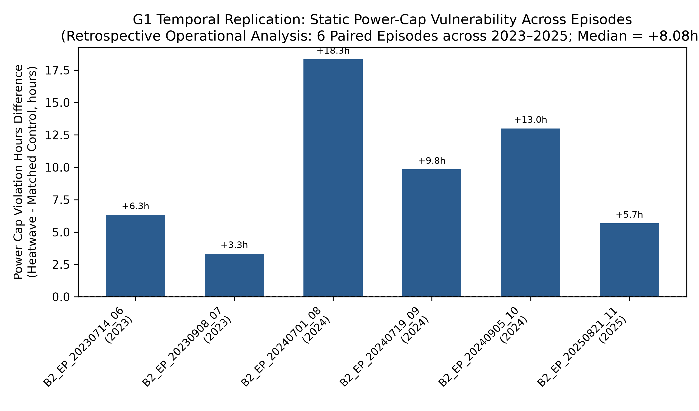
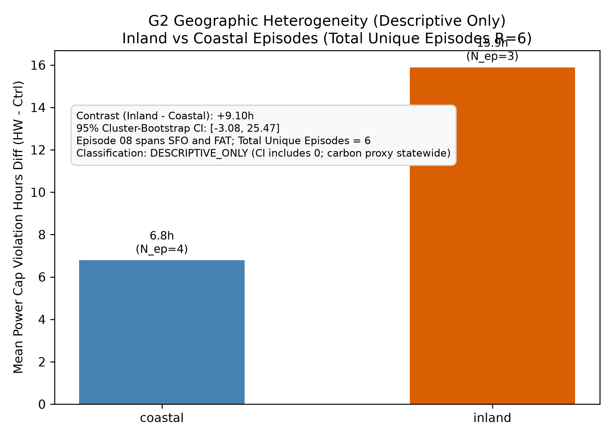
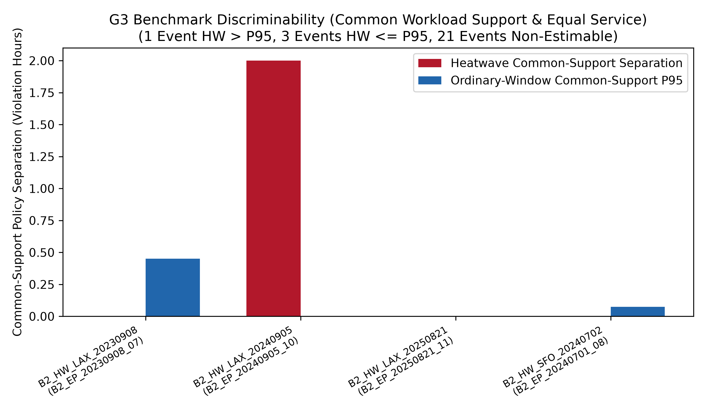
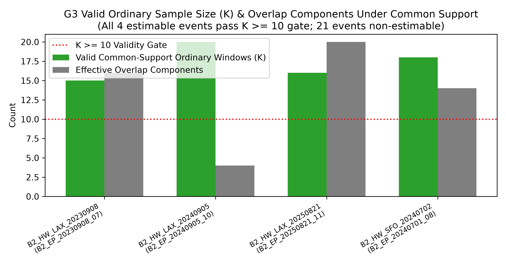

# 8. Figure explanation catalogue

The PNG figures below were inventoried; the four B2 figures and representative v1 figures were visually inspected. SVGs duplicate P5.5 PNG content. P6 F2/F3 are Markdown status artifacts because the required allocation/causal evidence was unavailable.

## 8.1 B2 figures

### Figure 4 — G1 temporal replication

Path: `../../data/v2/figures/fig4_g1_temporal_replication.png`; generator: `evaluation/p12_b2_reporting.py`; source: episode metrics. X is six paired regional episodes (2023–2025); Y is static heatwave-minus-control power-cap violation hours. All bars are positive: approximately 6.3, 3.3, 18.3, 9.8, 13.0, 5.7; title reports median +8.08h.

What it demonstrates: narrow modeled static vulnerability recurs. It does not demonstrate lower cost/carbon, policy superiority, or the broad boundary claim. Professor script: “Each bar is an episode-level paired difference, not a simulation count. All six are positive, so static scheduling violates the modeled cap longer in heatwaves, but this is a retrospective result under our facility model.”

### Figure 5 — G2 geographic heterogeneity

Path: `../../data/v2/figures/fig5_g2_geographic_heterogeneity.png`; generator/source as above. X is coastal/inland; Y mean violation-hour difference. Coastal is 6.8h (four episode memberships), inland 15.9h (three); annotation gives +9.10h and CI [−3.08,25.47]. Episode 08 spans both groups, leaving six unique episodes.

What it demonstrates: a descriptive point difference, not significant/confirmatory heterogeneity. The bar chart can visually overstate certainty because it does not draw error bars and memberships overlap. Script: “Inland is higher descriptively, but the cluster interval crosses zero and the carbon proxy is statewide, so I do not claim geographic carbon or statistically established regional effects.”

### Figure 6 — G3 heatwave versus ordinary P95

Path: `../../data/v2/figures/fig6_g3_heatwave_vs_ordinary_p95.png`. X is four estimable events; Y is common-support policy separation in violation hours. Red is heatwave separation, blue ordinary P95. Only LAX 2024 has heatwave 2h above ordinary P95 0; three events are within/tied.

The title correctly exposes 21 non-estimable catalogue events, but the displayed estimable non-SFO comparisons are compromised by SFO forecast transfer. Script: “Only four events survived common-support/equal-service filtering, and only one exceeded its ordinary tail. Most of this evidence fails the forecast audit, so G3 is not established.”

### Figure 7 — ordinary K and overlap components

Path: `../../data/v2/figures/fig7_g3_ordinary_k_and_overlap.png`. Green is valid ordinary K (15,20,16,18); gray is effective overlap-component count (about 15,4,20,14); dotted red is K=10 gate. It shows nominal K adequacy but also dependence—especially LAX 2024, where 20 windows collapse to four overlap components. Script: “All four pass the nominal K gate, yet overlap means K is not an independent sample size; that weakens the empirical P95.”

## 8.2 Frozen v1 figures

### P6 F1 — event-level policy outcome contrasts

Path: `../../data/figures/p6_f1_event_policy_contrasts.png`; generator `evaluation/p6_validity.py`; source event/pairwise metrics. A 3×3 grid: rows are the three confirmation triplets; columns heatwave/control/event-blind; bars are static, capacity-aware, full-thermal cost at 3× capped/medium. It shows nonzero policy separation in heatwaves for the first two triplets, a control separation for the first, and ties in blind windows/third event. Cost bars are only interpretable where equal-service requirements hold. Script: “The event window exposes differences in two triplets, but no winner reverses and one control also separates; this supports benchmark discriminability only partially.”

### P6 F4 — H1/H3 consistency

Path: `../../data/figures/p6_f4_h1_sensitivity.png`. Left: H1 boundary effects −0.5, −0.5, 0 with median line. Right: 24,24,0 heatwave nonzero gaps versus zero blind gaps. It demonstrates frozen-rule support/partial support, not population inference.

### P6 F2/F3 status artifacts

Paths: `../../data/figures/p6_f2_allocation_distance_status.md` and `p6_f3_forecast_regret_status.md`. They explicitly state allocation distance/forecast regret cannot be plotted because hourly allocations and a controlled forecast substitution are absent. These are honest “not estimable” deliverables.

## 8.3 Earlier exploratory P5 figures

Generated by `analysis/figures.py` from benchmark and source tables:

| Figure | Axes/meaning | Proper interpretation |
|---|---|---|
| `p5_fig1_signal_distributions.png` | boxplots of temperature, demand, LMP, carbon for one 120h event/control | descriptive development comparison |
| `p5_fig2_signals_time_series.png` | hour 0–119; temperature, price, demand event vs control | event is hotter with different market/demand profiles; no causality |
| `p5_fig3_phase_behavior.png` | phase boxplots for temperature and price | within-event descriptive phases |
| `p5_fig4_lag_relationships.png` | lag −24…+24 vs Pearson r | association, not causal lead/lag mechanism |
| `p5_fig5_policy_performance.png` | development policy metrics | exploratory, outside frozen confirmation |

## 8.4 P5.5 figures

Generated by `analysis/p5_5_figures.py`; each PNG also has SVG:

| Figure | Content | Caveat / 30-second explanation |
|---|---|---|
| `p5_5_fig1_cost_carbon_pareto` | cost vs carbon scatter/frontier by policy | exploratory grid; “shows tradeoffs, not universal dominance” |
| `p5_5_fig2_forecast_error_sensitivity` | policy outcome/savings versus noise | forecast scenarios are synthetic; cohort size must stay comparable |
| `p5_5_fig3_workload_capacity_pressure` | metrics across workload/resource stress | diagnoses where capacity binds |
| `p5_5_fig4_feasibility_sla_heatmap` | rows multiplier×resource stress; columns five policies; left feasibility, right completion | 270-scenario development grid, not B2/v1 confirmation |
| `p5_5_fig5_event_vs_control` | policy metrics by event/control | one development pair; descriptive |
| `p5_5_fig6_comparator_optimality_gaps` | heuristic gap to exact small-instance comparator | validates small cases only, not full-grid optimality |

No PDF, JPG/JPEG, or scientific HTML chart files were found under `data/`; the repository has HTML presentation pages under `docs/`, not primary result figures.

